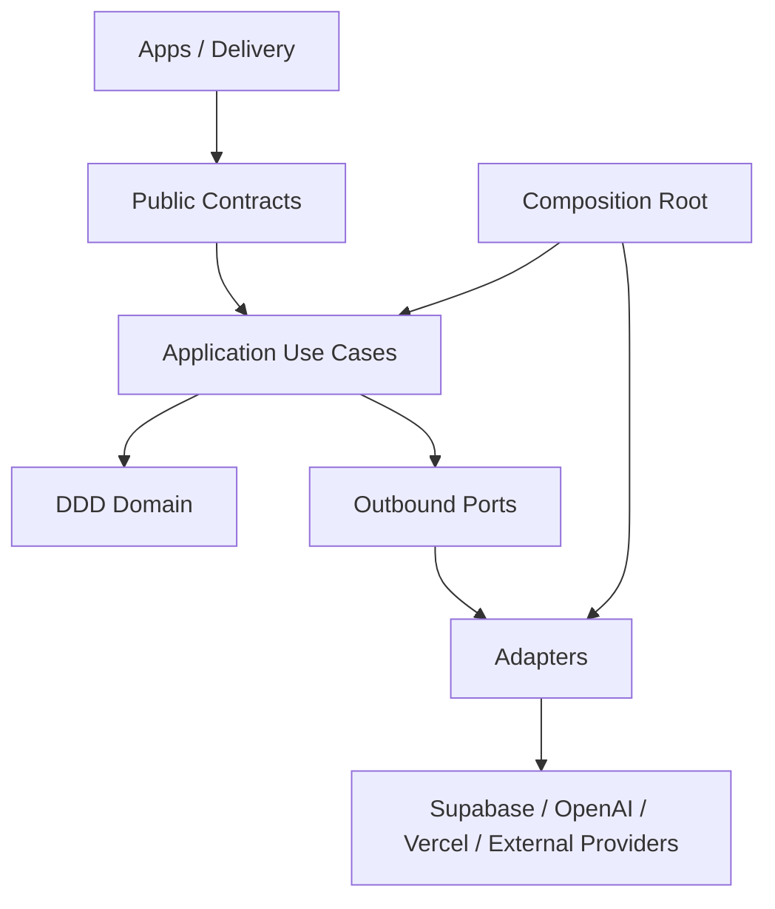
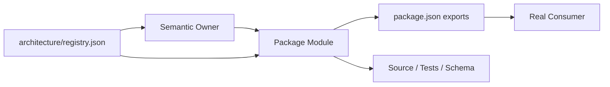

# Repository architecture

Root DDD and hexagonal architecture map. Each Owner-specific design is in `packages/<Owner>/ARCHITECTURE.md`.

## Rules

- Domain owns business invariants and state decisions.
- Application coordinates use cases and ports.
- Contracts expose stable DTOs and ports.
- Adapters implement persistence, transport, and provider protocols.
- Composition wires dependencies and contains no business decisions.
- Cross-package imports use public exports only.
- `semanticOwner` comes from `architecture/registry.json`; package name is an implementation path.
- Source, manifests, schemas, tests, and provider readback remain evidence.

## Owner diagrams

Each first-level package has `packages/<Owner>/ARCHITECTURE.md`; resolve `<Owner>` through `architecture/registry.json#modules` and its `semanticOwner`.
