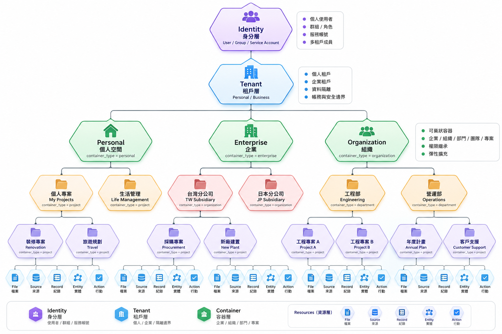

# Identity、Tenant、Container 與 Resource 目標架構

決策日期：2026-10-25。本文保存未來架構方向與其視覺說明；它不是目前 runtime、資料模型或授權實作的 authority。



## 目標模型

此架構分開管理範圍、事實與變更，不把它們混成單一階層：

```text
Identity
  → Tenant（資料隔離與帳務範圍）
    → Container（可巢狀的業務或工作空間）
      ↘ 資源的可見性、管理範圍與授權

Source ── lineage ──> Record ── evidence ──> Entity
   └──────────────────────────────> Action 的輸入、產出或證據
```

### Scope layers

- **Identity**：User、Group、Service Account 與多租戶成員資格。
- **Tenant**：Personal 或 Business 的資料、帳務與安全隔離範圍。
- **Container**：Personal、Enterprise、Organization、Department 或 Project 等可巢狀工作空間；它管理範圍與治理，不自動成為其內所有資料的唯一 Owner。

### Resource facts

- **Source**：原始或外部來源，例如檔案、API 回應或表單提交。
- **Record**：由 Source 取得、正規化或版本化的觀測／紀錄；它可以只是證據，尚未必然成為業務事實。
- **Entity**：可被長期識別的業務主體，例如客戶、專案、合約或設備；每一個耐久 Entity 必須有唯一 authoritative Owner。
- **Action**：人或系統的意圖與執行結果；它可讀取或產生 Source、Record、Entity revision 與 receipt，不是假定永遠排在 Entity 之後的最後一層。

## 關係模型

此目標模型保留兩條正交關係，避免以單一 parent 欄位同時表達治理與證據。

| 關係 | 用途 | 必要限制 |
| --- | --- | --- |
| **Containment** | Container 管理哪些 Resource、其可見範圍與管理生命週期。 | Container 可巢狀但預設無環；多個 Container 對同一 Entity 使用 membership/reference，不複製 Entity。 |
| **Lineage** | Source 如何形成 Record、Entity revision 與 Action receipt 的可追溯證據圖。 | 關聯固定至精確 revision／receipt；它不授予讀取、寫入或確認權限。 |

## 硬約束

1. **Tenant isolation**：Containment 與 Lineage 預設不得跨 Tenant；跨 Tenant 協作必須是明確、受授權且可稽核的 contract。
2. **Unique authority**：Container 決定可見與操作範圍，不改變 Entity 的唯一 Owner；Entity 出現在多個 Container 不得造成重複的事實來源。
3. **Scoped authorization**：讀取或跨 Container 關聯前，分別檢查來源與目標 Container 的當前權限；取得關聯 ID 或 lineage edge 不授予資料存取權。
4. **Evidence is not authority**：Source、Record、Lineage 與 Action output 是輸入或證據；只有各 Entity Owner 的明確 transition 才能形成正式業務事實。

圖中的層級與範例只描述期望的容器化資訊架構；它不自行建立全域角色、權限繼承、租戶資料表、Container type、Resource type，或任何 runtime capability。

## Promotion 條件

任一部分成為 current capability 前，必須先確認其 durable fact 的唯一 Owner、授權與隔離規則、跨 Owner contract、資料 authority、交易／replay／recovery 行為，以及實際 consumer。再同步更新對應的 `architecture/registry.json#domain`、implementation/data topology、schema、source、tests 與 Owner contract。

## Current-state routing

- [Account identity design](account-identity-design.md)
- [Enterprise target design](enterprise-target-design.md)
- [Organization target design](organization-target-design.md)
- [System invariants](../../rules/system-invariants.md)
- [Machine-readable architecture sources](../../../architecture/)
