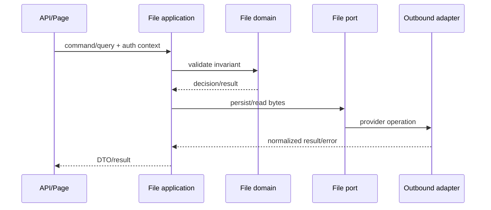
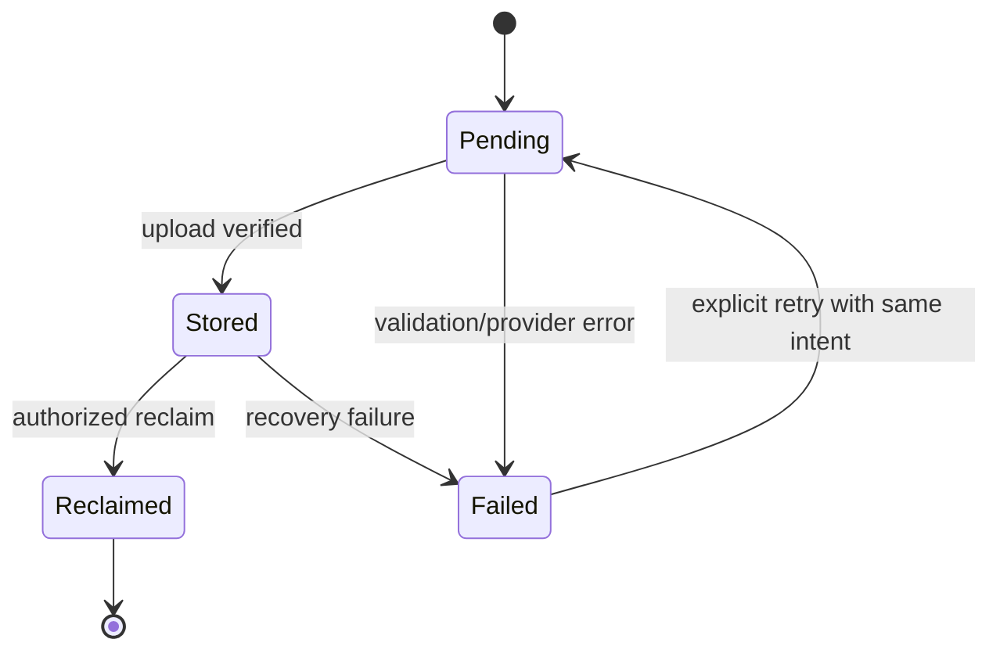

# File Owner 入口

File 是原始檔案生命週期的唯一 Owner。這份文件只負責路由，不複製 source 的實作細節。

## AI 必須遵守

- 先讀 [package constraints](../../packages/file/AGENTS.md)，再讀 source、manifest 與 tests。
- 先確認 consumer 與 contract；不以舊文件或抽象最佳實務取代 repository evidence。
- File business logic 放在 `packages/file/src`；API/Page 只做 transport mapping 與調用。
- Web Request 的 File 指令／查詢轉譯由 `packages/file/src/adapters/inbound/http.ts` 擁有；`apps/web` 只接上 Session、Repository locator、Origin 與畫面。

## 決策流程



## 來源與證據

| 項目 | 真實來源 |
| --- | --- |
| manifest、exports、scripts | [packages/file/package.json](../../packages/file/package.json) |
| domain 與 application | [packages/file/src](../../packages/file/src/) |
| 行為與回歸 | [packages/file/test](../../packages/file/test/) |
| public reference consumer 約束 | [packages/file/AGENTS.md](../../packages/file/AGENTS.md) |

## 變更後命令

```sh
pnpm --filter @line_bot_v1/file typecheck
pnpm --filter @line_bot_v1/file test
pnpm check:repository
```

## 狀態圖


