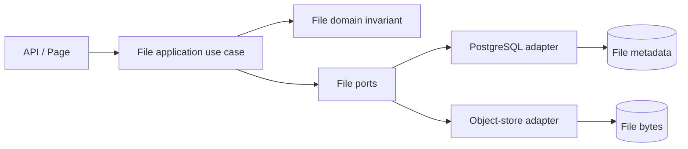

# File 第一性原理與效能重構設計

Status: runtime 實作採用下述 File 邊界，並參考 #441 加入直傳、統一 Upload Intent 流程與 metadata overview；實際入口與行為以 `packages/file` 及 `apps/web/src/modules/file` source/tests 為準。未修改 production schema，未量測真實網路 p50/p95；下方涉及 schema cutover 的前置條件仍適用。

## 交談要求

- 以第一性原理重新檢查 File。
- 以效能為主要目標，降低複雜度與低效能。
- File 符合 DDD 與 Hexagonal Architecture。
- 主要程式碼集中在 `packages/modules`；API 與 Page 只負責調用。

交談沒有提供具體 SQL、API 相容策略、benchmark 或 migration window；以下設計不把缺口假設成已決定。

## 已確認的 repository evidence

| 項目 | 現況證據 |
| --- | --- |
| File runtime boundary | `packages/file/src/domain`、`application`、`contracts`、`adapters/outbound`、`composition/bootstrap` |
| File public surface | `packages/file/package.json` 的 use case、domain、contract、bootstrap exports |
| File persistence | `packages/integration-supabase/src/schemas/615_files.sql` |
| File tests | `packages/file/test/*.test.ts`，並由 Contract、Intelligence tests 使用 File |
| Web boundary | `apps/web/src/modules/file` 與 `/api/repository-files` 呼叫 File package |
| transaction/replay | `FileTransactions`、`file_upload_intents`、`file_commands` |
| revision invariant | `repository_files` head + `file_revisions` version/parent/hash constraints |

## 第一性原理模型

File 的最小責任是：

1. 驗證 repository-scoped file revision 的 identity、size、media type 與 digest。
2. 以必要的 persistence transaction 固化 revision metadata。
3. 以可驗證的 object operation 保存與讀取 bytes。
4. 讓 caller 以 stable public contract 取得 revision，不把 provider 或資料庫模型洩漏到 API/Page。

Processing、Contract interpretation、WBS meaning 不在本設計新增 File responsibility；它們只能透過現有 public contract 取得 File revision。

## 目標結構

```text
packages/file/
├── src/domain/                 # identity、revision invariant、純 domain error
├── src/application/            # upload/read/list/reclaim use cases
├── src/contracts/              # ports、DTO、reference qualification
├── src/adapters/inbound/       # HTTP transport factory
├── src/adapters/outbound/      # PostgreSQL、object store、payload inspection
└── src/composition/bootstrap/  # concrete dependency wiring

apps/web/
└── src/modules/file/           # UI、Hook、互動狀態
```



## 效能設計方向

| 成本來源 | 設計方向 | 仍需 benchmark 的問題 |
| --- | --- | --- |
| payload 記憶體複製 | 以 bounded payload API 為邊界；避免 application 重複 materialize bytes | provider SDK 是否支援真正 streaming |
| upload transaction 持有外部 I/O | 維持 prepare → object I/O → finalize 三段式 | unknown outcome、retry latency、併發衝突 |
| revision list 查詢 | 以 `(repository_id, id)` keyset pagination，固定 bounded page | page size 與 query plan |
| revision read | metadata 與 object read 分離，先完成資格/版本驗證再讀 bytes | authorization query latency |
| replay lookup | request identity 使用唯一索引與單次 lookup | hot-key contention |

任何「更快」結論都必須由 package benchmark 或 database `EXPLAIN` 證明。

## 資料庫目標邊界

### 保留的 File authority

- `repository_files`：File aggregate/head。
- `file_revisions`：不可變 revision metadata 與 chain。
- `file_upload_intents`：外部 object I/O 前的 durable intent。
- `file_commands`：File command replay receipt。

### 必須先確認再遷移

- `615_files.sql` 內 processing relations 的最終保留期限與讀取 consumer。
- processing receipts 是否已完全由 Intelligence history contract 接管。
- 是否允許新增 schema file 或需要 provider migration。
- production 資料量、索引使用率、鎖等待與 object-store readback evidence。

在上述問題有 evidence 前，不刪除 table、欄位、constraint 或歷史資料。

## 分階段實作順序

1. **Inventory gate**：列出 public exports、consumer、SQL relation、query 與 test；不得先改名。
2. **Domain gate**：確認 File revision invariant 只在 domain 定義一次，application 只協調。
3. **Port gate**：縮窄 outbound port，移除沒有 variation、policy 或 technology boundary 的轉發層。
4. **Query gate**：取得 list/read/pending/replay 的 query plan 與 latency baseline，再調整索引或 SQL。
5. **Storage gate**：驗證 prepare/finalize/readback/recovery，不能以 bucket 存在替代 object evidence。
6. **Consumer gate**：API/Page 只保留 mapping 與 invocation，更新 Contract、Intelligence、WBS consumer tests。
7. **Cutover gate**：只有 count/hash、rollback/recovery、authorization/isolation/readback evidence 完整後才切換 schema。

## 不可變條件

- 不以 compatibility wrapper 或 alias 掩蓋錯誤 ownership。
- 不在 File domain/application 直接依賴 Supabase、HTTP、Next.js 或 SQL client。
- 不在 API/Page 複製 File business rule。
- 不在未確認 production consumer 前刪除資料表或歷史資料。
- 不以 local test 綠燈宣稱 production migration 完成。

## 下一個實作前置條件

- File、Intelligence、Contract、WBS 的完整 public consumer graph。
- File 相關 SQL 的實際 query inventory 與 `EXPLAIN` baseline。
- 本地 schema/test database 的資料量與併發測試基線。
- production 是否已有資料；若有，需有 migration/recovery/rollback 授權與策略。

完成這些前置條件後，才可將本設計拆成 source change、schema change、consumer change 與 validation evidence。
