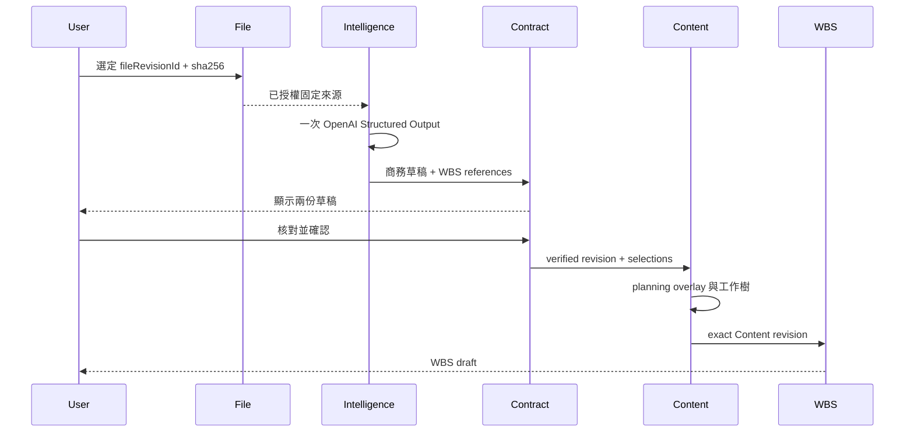

# Commercial task：完整實施計畫

狀態：實作中；以下是待交付範圍，不代表能力已完成。本計畫承接新的單一任務流程；舊商務計畫已移除，歷史由 Git 保存。

## 目標與操作

同一 taskId 貫穿 File → Intelligence → Contract → Content → WBS。使用者 start 後檢視商務與 WBS 兩份草稿，完成核對與規劃選擇後 confirm；status 查詢，resume 恢復已發動操作。

## 六段交付

| 段落 | 範圍與主要來源 | 驗收條件 | 盤點狀態 |
| --- | --- | --- | --- |
| 1 單一任務契約 | Web commercial-task transport、File pending state；統一 taskId、start/status/resume/confirm、來源與目標 Project | 前端只管理 task identity；回應 identity 一致；舊 pending 可恢復；body budget、origin、identity、錯誤及 Sentry exclusion 完整 | 部分實作，尚未驗收 |
| 2 一次解析、兩份草稿 | Intelligence profile/decoder/result、Contract normalization、File review | 一次模型呼叫；商務資料完整；WBS references 指向已存在來源列；兩份草稿實際可讀；舊 result 讀回正確 | 技術 payload 已有 WBS references，Contract/UI 未接完 |
| 3 Contract 核對確認 | Commercial documents use case、store、review validator、canonical SQL | exact draft version 核對；必要修正；verification evidence；CAS、receipt、併發及 rollback；可讀回 verified revision | 未完成 |
| 4 Content 規劃 | Content command、source port、expansion、persistence、host composition | 每個來源 row 明確處置；數量/measure/理由有效；只保存 planning overlay、source revision/hash 與自己的工作樹；不複製完整商務 JSON | 新 Commercial 路徑未完成 |
| 5 WBS 建立 | ContentWbsExpansionReader、Project WBS command/store、provenance | 消費 exact Content revision；保留 commercial source pins；Project access/CAS/replay 正確；建立整份 WBS draft | 既有能力可重用，新 provenance 未接完 |
| 6 整合與交付 | task confirm/status/resume、Web UI、舊入口收斂、schema/deployment readback | 各階段失敗可恢復；Content 成功而 WBS 失敗時只恢復 WBS；檢查、測試、build、遠端 schema 與實際流程驗證完成 | 未完成 |

## 實作決策與前置修正

- taskId 決定性推導每階段 command ID；不同核對意圖不能共用已提交 receipt 的命令 ID。confirm payload 必須綁定版本與 fingerprint。
- Web host 組裝跨 owner 流程；各 owner 執行自己的授權、交易、CAS、receipt。Intelligence job 不擴充成跨 owner 工作表。
- 單一完整商務 JSON 由 Contract 擁有；Content 保存規劃決策，WBS 保存工作樹。三者以 immutable revision、hash、row identity 串接。
- verification 狀態如何保存，須先對照現有 immutable revision/SQL 契約收斂；不得為省一份 JSON 原地覆寫已被引用的歷史事實。
- 目前 task transport 推導新 command/document IDs，但 File panel 仍按舊 IDs 驗回應；第 1 段先修正此不一致，再宣稱接線成功。
- 新 route 尚須補 bounded body、結構化原始錯誤、strict input、Sentry exclusion 與授權前置檢查；typecheck 不等於此段完成。
- 新 provider schema 目前仍是 observations、semanticHints、wbsDraft，尚非 commercialDraft/wbsDraft 完整輸出；prompt、decoder、normalizer 與 UI 必須共同驗收。

## 驗證與完成門檻

1. 每段以 Serena v2/LSP symbol references 定位 consumer，再同步 public contract、source、SQL、tests 與實際 UI。
2. 先跑受影響 owner 行為測試與 typecheck；跨 owner 檢查加入 dependency、repository、schema、Web build。
3. 整合覆蓋：一次 dispatch、拒絕/不完整輸出、來源不符、過期核對、重複 confirm、Content rollback、WBS 失敗恢復、權限撤銷、reload/舊 pending。
4. canonical SQL 經本地 Docker stack 驗證後按專案 reconciliation 規則部署，讀回 catalog/RLS/grants；保留歷史 result/revision/receipt。
5. 推送後檢查 PR required checks、review、部署與 merge 結果；只有可實際從 File 走到 WBS draft 才算完成。

## 程式碼收斂與刪除門檻

以下候選屬於本計畫的執行清單；實作前須以 Serena v2/LSP references 與 bounded text search 核對所有 production、test、export、route consumer。

| 目前位置 | 收斂方式 | 刪除前置條件 |
| --- | --- | --- |
| `apps/web/src/modules/file/commercial-intake-state.ts` 的隨機 analysis/document/draft IDs 與 target persistence | 新 task 只保存 taskId、來源及必要恢復資訊；子命令由 server 推導 | 舊 localStorage pending 有明確讀回/恢復路徑；回應校驗同步 |
| `apps/web/src/modules/file/commercial-intake-panel.tsx` 的 status 後額外 document read、分散恢復編排 | task 回應提供授權後的 stage、receipt 與兩份 draft views；UI 只呈現及送使用者意圖 | task read 重驗來源權限，stale response/session clearing 測試通過 |
| `apps/web/src/modules/file/file-requests.ts` 的三組商務入口 | 新流程統一 commercialTask；共用 session/denial/raw error 處理 | 所有 consumer 遷移；舊結果查詢仍可用 |
| `apps/web/src/app/api/document-intakes/route.ts`、`commercial-documents/route.ts` | task route 完整後移除無 consumer 的舊 transport | 舊 pending/client 盤點與恢復完成；不能先刪 receipt 查詢 |
| `apps/web/src/modules/document-intake/commercial-intake-http.server.ts` 的 resource 分支及重複 request 解析 | task transport 直接使用 owner public capability | 新 task 不再重建 Request 轉呼叫舊 handler；全部行為測試遷移 |
| `apps/web/src/modules/document-intake/commercial-task-http.server.ts` 的 Request 重建 | 驗證一次後直接呼叫 application orchestration | owner commands/DTO 已收斂；移除雙重 JSON parse/HTTP 自我轉送 |
| 新 task 與現有 Content/WBS UI 的重複商務匯入操作 | 新商務流程由 task confirm 編排，保留一般 Content/WBS 編輯能力 | 新流程完整跑通，實際 references 證明重複入口無用途 |

保留 Intelligence dispatch/result、Contract 商務事實、Content planning overlay、WBS provenance、舊 pending/history 讀回，以及各 owner 的授權、版本、CAS、receipt 與 failure recovery。不得以行數減少取代 owner 責任或刪除 immutable history、來源 pin、版本與恢復資料。
