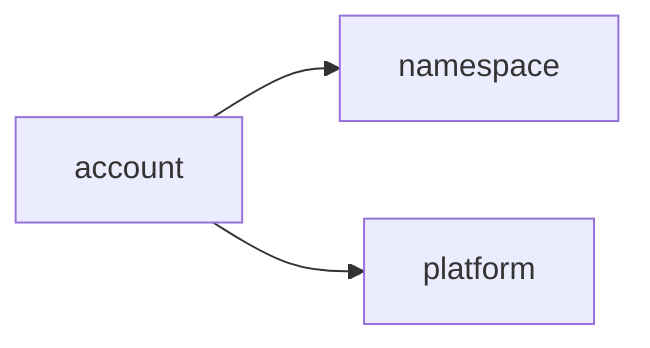
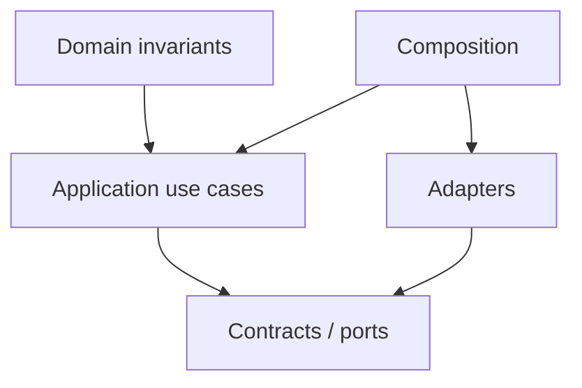

# account Owner Architecture

<!-- Generated from package.json and architecture/modules/*.json. -->

| Field | Value |
| --- | --- |
| Package module | @line_bot_v1/account |
| semanticOwner | account |
| moduleKind | domain-module |

## Boundary and dependencies

## Domain boundary

## Public surface

- ./application/achievements
- ./application/follows
- ./application/manage-users
- ./application/profile
- ./application/user
- ./application/user-profile-status
- ./contracts/dto/user-profile-status
- ./contracts/output/achievements
- ./contracts/output/follows
- ./contracts/output/identity-provider
- ./contracts/repositories/profile
- ./contracts/repositories/user-profile-status
- ./contracts/user-management
- ./domain
- ./domain/user
- ./postgres
- ./supabase-identity

## Evidence

- [Manifest](./package.json)
- [Source](./src/)
- [Tests](./test/)
- [Module topology](../../architecture/modules/account.json)

