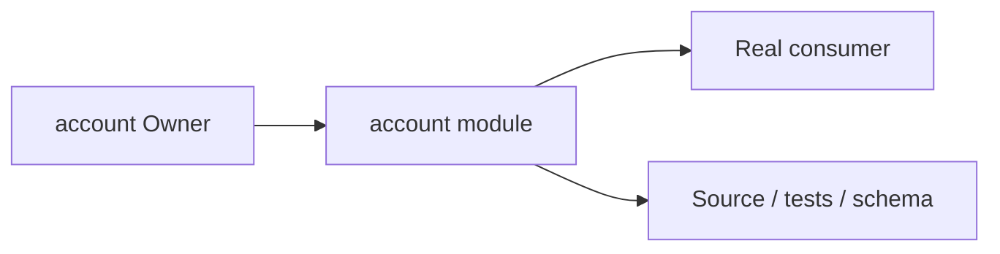
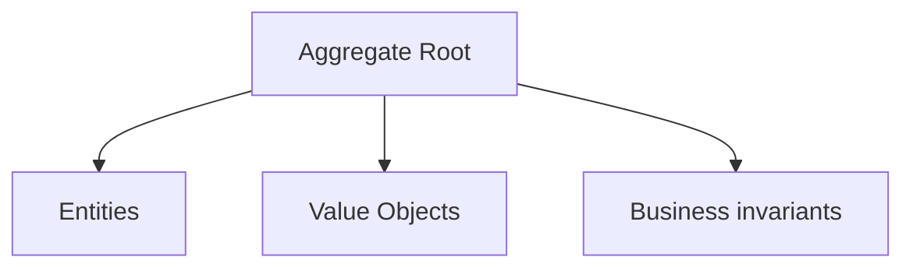
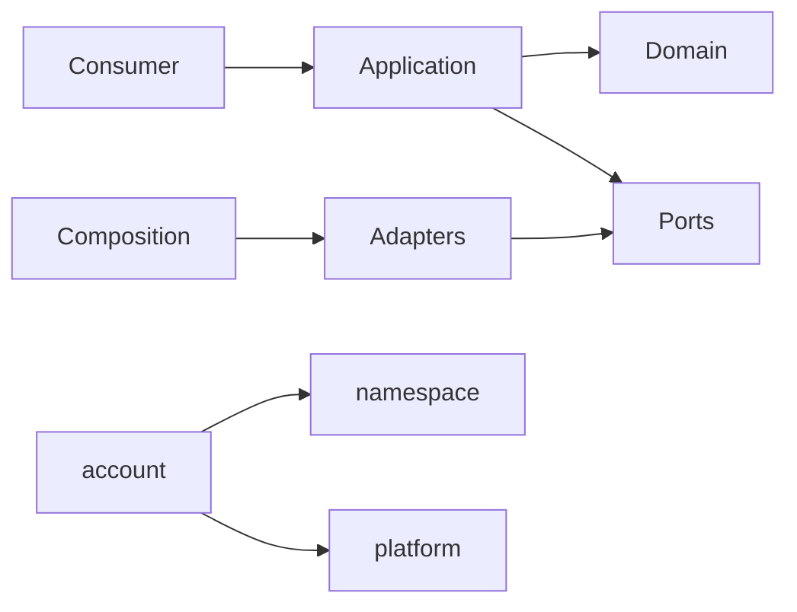

# account Owner Architecture

<!-- Generated from package.json and architecture/modules/*.json. -->

## Context Card

| Field | Value |
| --- | --- |
| Owner | account |
| Module | @line_bot_v1/account |
| Kind | domain-module |

## Context Boundary

## Domain Model

## Boundary and Dependencies

## Key Invariants

- Domain invariants remain owned here.
- Authorization, isolation, replay, and version rules fail closed.

## Public Surface

- ./application/achievements
- ./application/follows
- ./application/manage-users
- ./application/profile
- ./application/user
- ./application/user-profile-status
- ./contracts/dto/user-profile-status
- ./contracts/output/achievements
- ./contracts/output/follows
- ./contracts/output/identity-provider
- ./contracts/repositories/profile
- ./contracts/repositories/user-profile-status
- ./contracts/user-management
- ./domain
- ./domain/user
- ./postgres
- ./supabase-identity

## Evidence

- [Manifest](./package.json)
- [Source](./src/)
- [Tests](./test/)
- [Module topology](../../architecture/modules/account.json)

