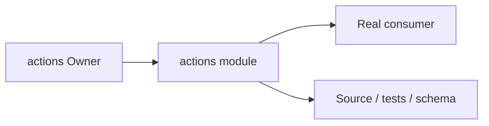
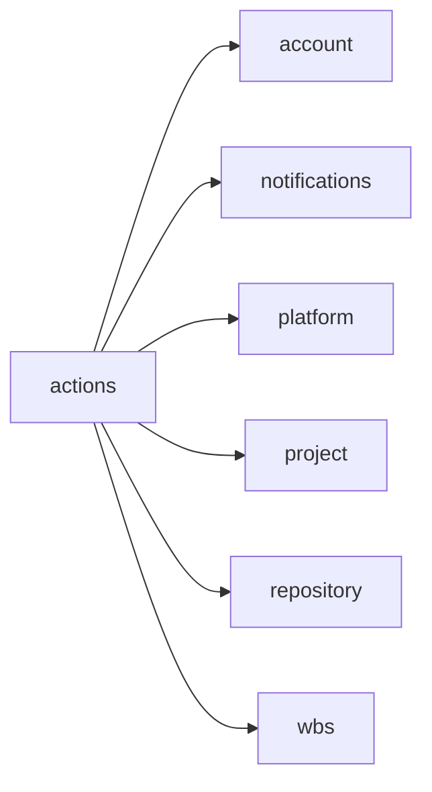
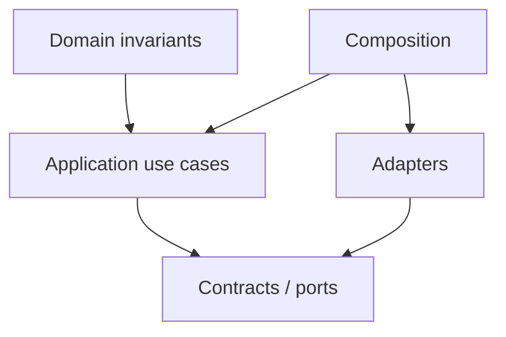
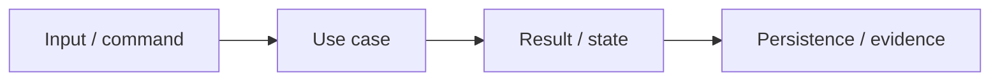

# actions Owner Architecture

<!-- Generated from package.json and architecture/modules/*.json. -->

| Field | Value |
| --- | --- |
| Package module | @line_bot_v1/actions |
| semanticOwner | actions |
| moduleKind | domain-module |

## Owner boundary

## Ubiquitous language

| Term | Meaning |
| --- | --- |
| Owner | actions |
| Module kind | domain-module |
| Package role | implementation module mapped through registry topology |

## Dependencies

## Domain boundary

## Invariants

- Domain invariants remain in this Owner.
- Authorization, isolation, replay, and expected-version rules fail closed.

## State and data flow

## Public functions

- ./application/use-cases/automation
- ./application/use-cases/project-automation
- ./application/use-cases/project-worker
- ./application/use-cases/worker
- ./composition/bootstrap/automation
- ./composition/bootstrap/project-automation
- ./composition/bootstrap/transfer-facts
- ./contracts/dto/automation
- ./contracts/dto/project-automation
- ./contracts/output/fixed-steps
- ./contracts/output/project-fixed-steps
- ./contracts/repositories/automation
- ./contracts/repositories/project-automation

## Evidence

- [Manifest](./package.json)
- [Source](./src/)
- [Tests](./test/)
- [Module topology](../../architecture/modules/actions.json)

