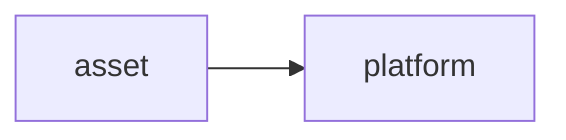
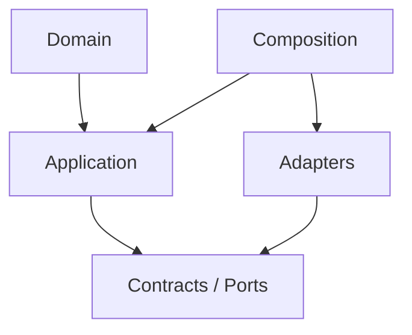

# asset Owner Architecture

<!-- Generated from package.json and architecture/modules/*.json. -->

| Field | Value |
| --- | --- |
| Package module | @line_bot_v1/asset |
| semanticOwner | asset |
| moduleKind | domain-module |

## Boundary and dependencies

## Hexagonal placement

## Public surface

- ./application/queries/asset-definition
- ./composition/bootstrap/postgres-asset-definition-query
- ./domain/entities/asset-definition
- ./domain/value-objects/asset-code

## Evidence

- [Manifest](./package.json)
- [Source](./src/)
- [Tests](./test/)
- [Module topology](../../architecture/modules/asset.json)

