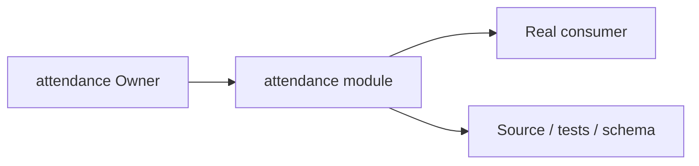
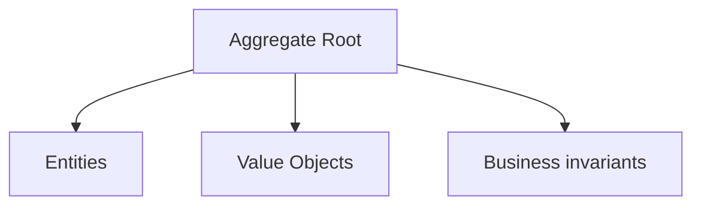
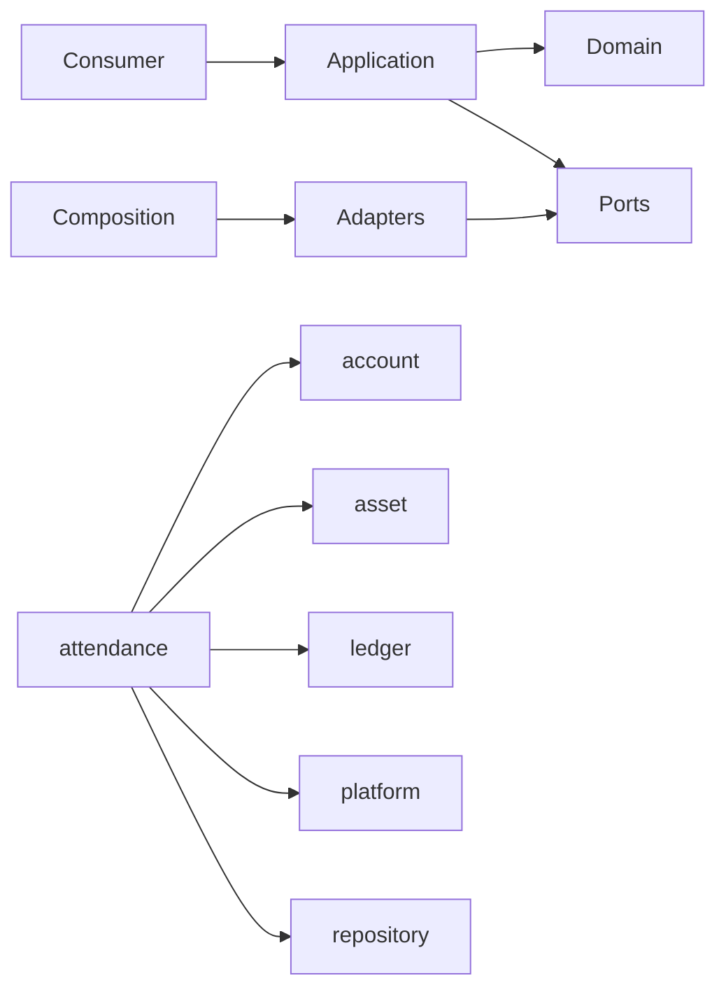

# attendance Owner Architecture

<!-- Generated from package.json and architecture/modules/*.json. -->

## Context Card

| Field | Value |
| --- | --- |
| Owner | attendance |
| Module | @line_bot_v1/attendance |
| Kind | domain-module |

## Context Boundary

## Domain Model

## Boundary and Dependencies

## Key Invariants

- Domain invariants remain owned here.
- Authorization, isolation, replay, and version rules fail closed.

## Public Surface

- ./application/clock
- ./application/maintenance
- ./application/supplements
- ./composition/bootstrap/postgres-attendance-store
- ./contracts/clock
- ./contracts/dto/attendance-client
- ./contracts/dto/attendance-presentation
- ./contracts/dto/attendance-supplement
- ./contracts/input/attendance-command
- ./contracts/input/attendance-supplement
- ./contracts/supplements
- ./domain/error
- ./domain/policies/attendance-view
- ./domain/value-objects/attendance-action
- ./domain/value-objects/location

## Evidence

- [Manifest](./package.json)
- [Source](./src/)
- [Tests](./test/)
- [Module topology](../../architecture/modules/attendance.json)

