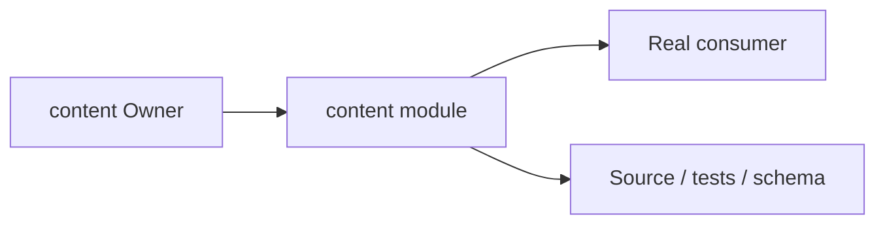
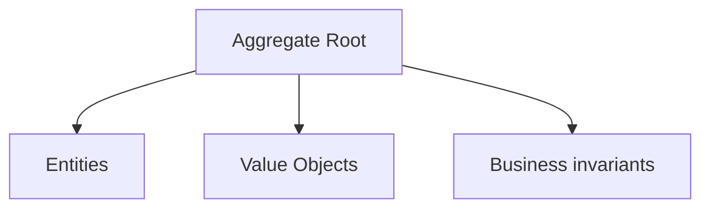
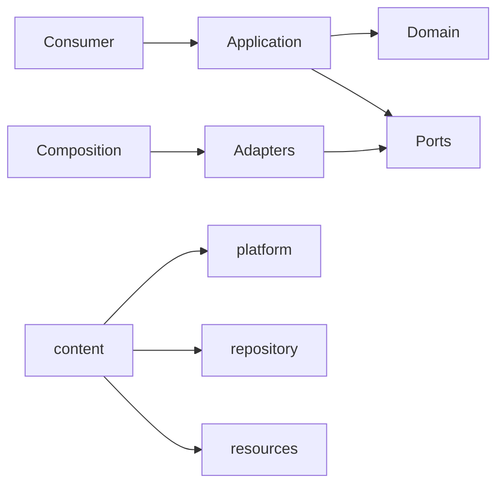

# content Owner Architecture

<!-- Generated from package.json and architecture/modules/*.json. -->

## Context Card

| Field | Value |
| --- | --- |
| Owner | content |
| Module | @line_bot_v1/content |
| Kind | domain-module |

## Implementation Status

| Area | Status |
| --- | --- |
| domain | present |
| application | present |
| contracts | present |
| adapters | present |
| composition | present |
| test | present |

## Context Boundary

## Domain Model

## Boundary and Dependencies

## Key Invariants

- Domain invariants remain owned here.
- Authorization, isolation, replay, and version rules fail closed.

## Public Surface

- ./application/use-cases/contract-document-expansion
- ./application/use-cases/plans
- ./composition/bootstrap/plan-references
- ./composition/bootstrap/plans
- ./composition/bootstrap/wbs-expansion
- ./contracts/output/plan-references
- ./contracts/output/wbs-expansion
- ./domain/error
- ./domain/plan-reference
- ./domain/quantity

## Evidence

- [Manifest](./package.json)
- [Source](./src/)
- [Tests](./test/)
- [Module topology](../../architecture/modules/content.json)

