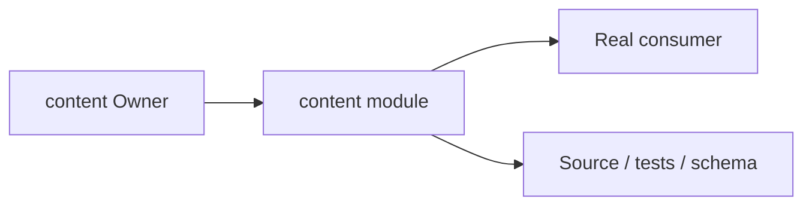
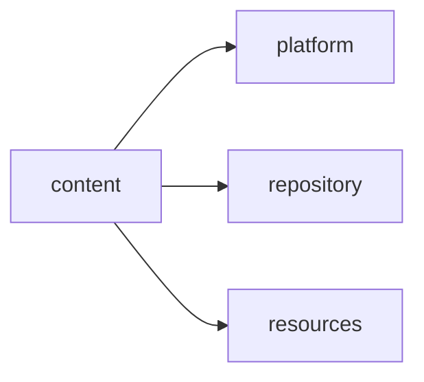
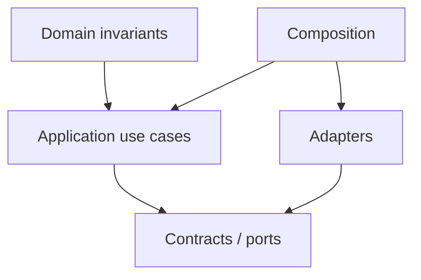
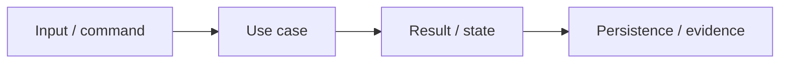

# content Owner Architecture

<!-- Generated from package.json and architecture/modules/*.json. -->

| Field | Value |
| --- | --- |
| Package module | @line_bot_v1/content |
| semanticOwner | content |
| moduleKind | domain-module |

## Owner boundary

## Ubiquitous language

| Term | Meaning |
| --- | --- |
| Owner | content |
| Module kind | domain-module |
| Package role | implementation module mapped through registry topology |

## Dependencies

## Domain boundary

## Invariants

- Domain invariants remain in this Owner.
- Authorization, isolation, replay, and expected-version rules fail closed.

## State and data flow

## Public functions

- ./application/use-cases/contract-document-expansion
- ./application/use-cases/plans
- ./composition/bootstrap/plan-references
- ./composition/bootstrap/plans
- ./composition/bootstrap/wbs-expansion
- ./contracts/output/plan-references
- ./contracts/output/wbs-expansion
- ./domain/error
- ./domain/plan-reference
- ./domain/quantity

## Evidence

- [Manifest](./package.json)
- [Source](./src/)
- [Tests](./test/)
- [Module topology](../../architecture/modules/content.json)

