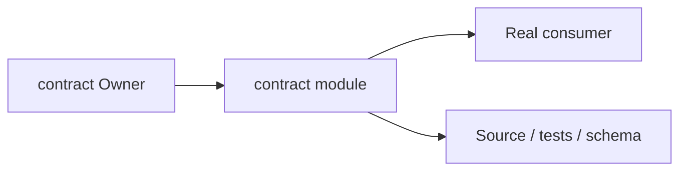
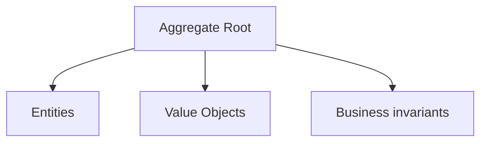
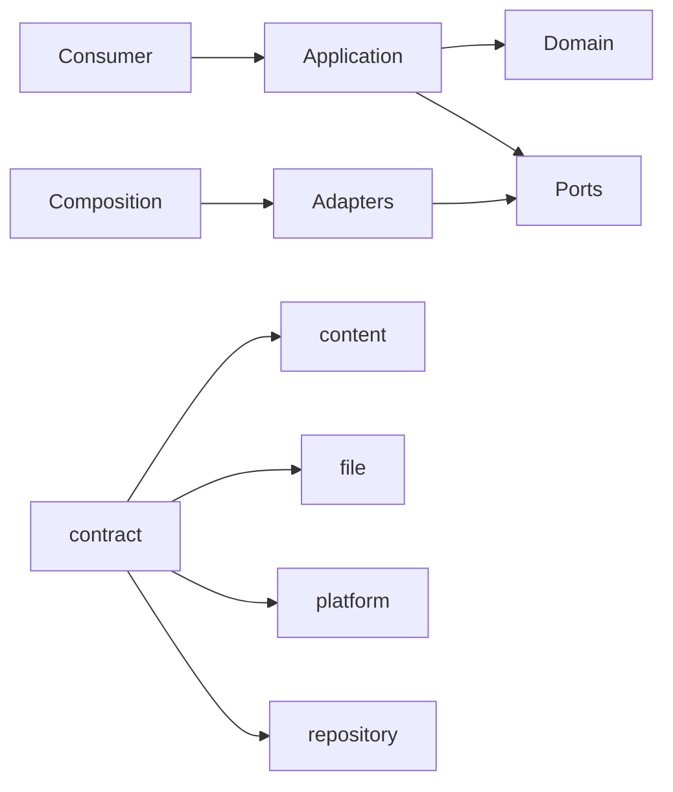

# contract Owner Architecture

<!-- Generated from package.json and architecture/modules/*.json. -->

## Context Card

| Field | Value |
| --- | --- |
| Owner | contract |
| Module | @line_bot_v1/contract |
| Kind | domain-module |

## Implementation Status

| Area | Status |
| --- | --- |
| domain | present |
| application | present |
| contracts | present |
| adapters | present |
| composition | present |
| test | present |

## Context Boundary

## Domain Model

## Boundary and Dependencies

## Key Invariants

- Domain invariants remain owned here.
- Authorization, isolation, replay, and version rules fail closed.

## Public Surface

- ./application/normalization/commercial-document
- ./application/use-cases/commercial-document-review
- ./application/use-cases/contracts
- ./composition/bootstrap/commercial-documents
- ./composition/bootstrap/contracts
- ./composition/bootstrap/documents
- ./composition/bootstrap/references
- ./contracts/input/document-intake
- ./contracts/output/commercial-document-review
- ./contracts/output/commercial-documents
- ./contracts/output/references
- ./domain/error
- ./domain/line-reference

## Evidence

- [Manifest](./package.json)
- [Source](./src/)
- [Tests](./test/)
- [Module topology](../../architecture/modules/contract.json)

