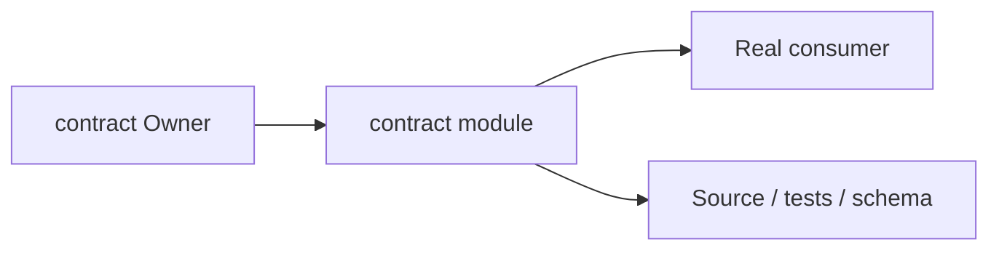
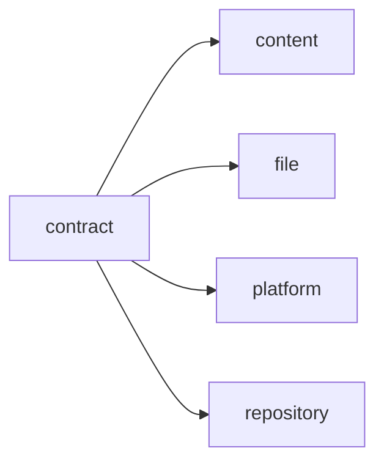
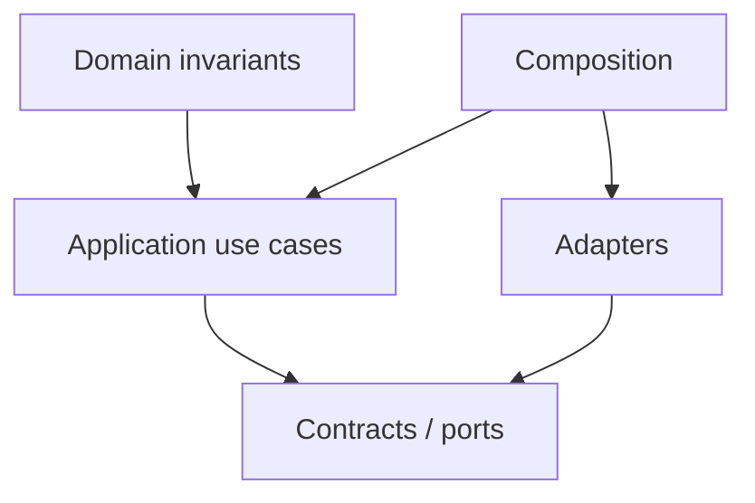
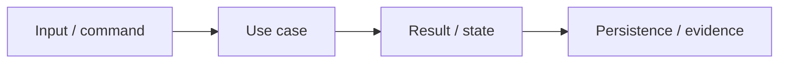

# contract Owner Architecture

<!-- Generated from package.json and architecture/modules/*.json. -->

| Field | Value |
| --- | --- |
| Package module | @line_bot_v1/contract |
| semanticOwner | contract |
| moduleKind | domain-module |

## Owner boundary

## Ubiquitous language

| Term | Meaning |
| --- | --- |
| Owner | contract |
| Module kind | domain-module |
| Package role | implementation module mapped through registry topology |

## Dependencies

## Domain boundary

## Invariants

- Domain invariants remain in this Owner.
- Authorization, isolation, replay, and expected-version rules fail closed.

## State and data flow

## Public functions

- ./application/normalization/commercial-document
- ./application/use-cases/commercial-document-review
- ./application/use-cases/contracts
- ./composition/bootstrap/commercial-documents
- ./composition/bootstrap/contracts
- ./composition/bootstrap/documents
- ./composition/bootstrap/references
- ./contracts/input/document-intake
- ./contracts/output/commercial-document-review
- ./contracts/output/commercial-documents
- ./contracts/output/references
- ./domain/error
- ./domain/line-reference

## Evidence

- [Manifest](./package.json)
- [Source](./src/)
- [Tests](./test/)
- [Module topology](../../architecture/modules/contract.json)

