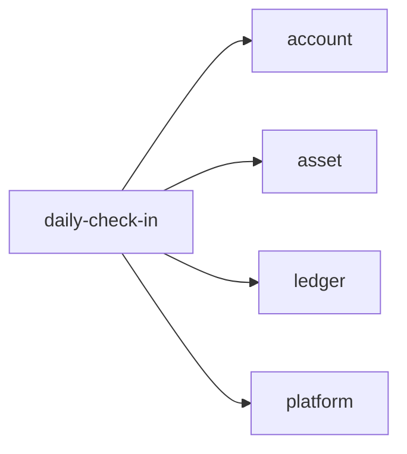
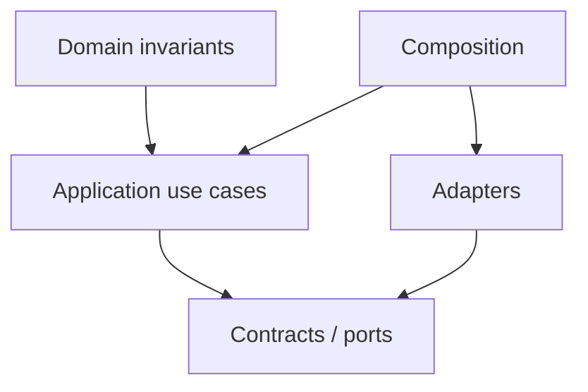

# daily-check-in Owner Architecture

<!-- Generated from package.json and architecture/modules/*.json. -->

| Field | Value |
| --- | --- |
| Package module | @line_bot_v1/daily-check-in |
| semanticOwner | daily-check-in |
| moduleKind | domain-module |

## Boundary and dependencies

## Domain boundary

## Public surface

- ./application/daily-check-in
- ./composition/bootstrap/postgres-daily-check-in-store
- ./domain/error

## Evidence

- [Manifest](./package.json)
- [Source](./src/)
- [Tests](./test/)
- [Module topology](../../architecture/modules/daily-check-in.json)

