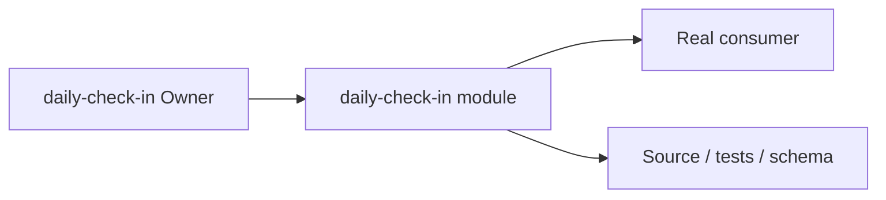
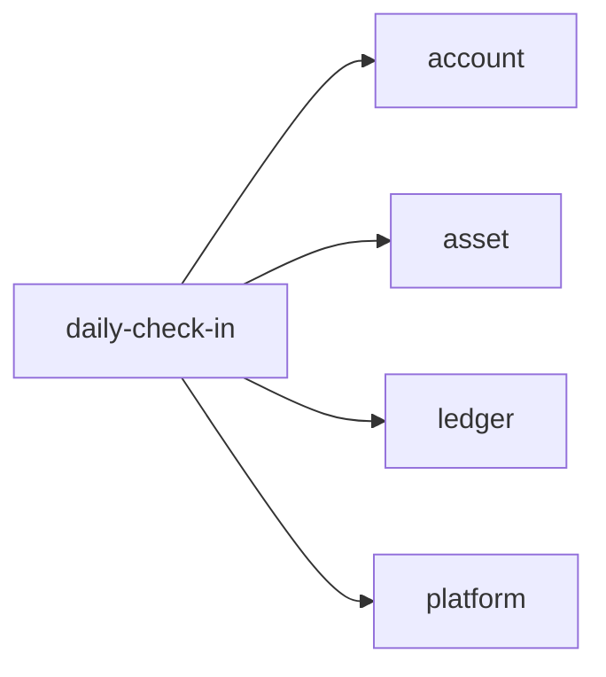
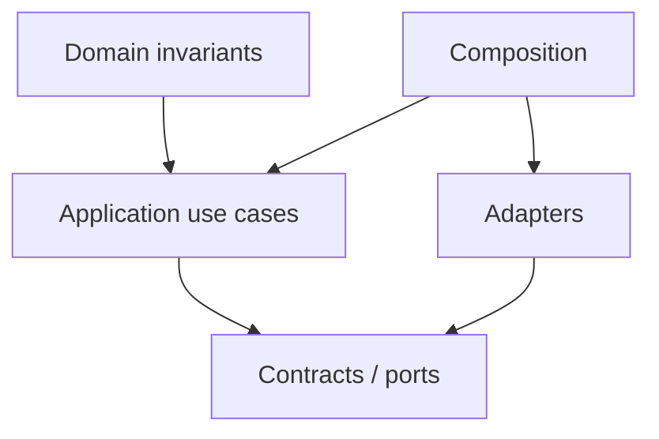
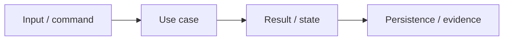

# daily-check-in Owner Architecture

<!-- Generated from package.json and architecture/modules/*.json. -->

| Field | Value |
| --- | --- |
| Package module | @line_bot_v1/daily-check-in |
| semanticOwner | daily-check-in |
| moduleKind | domain-module |

## Owner boundary

## Ubiquitous language

| Term | Meaning |
| --- | --- |
| Owner | daily-check-in |
| Module kind | domain-module |
| Package role | implementation module mapped through registry topology |

## Dependencies

## Domain boundary

## Invariants

- Domain invariants remain in this Owner.
- Authorization, isolation, replay, and expected-version rules fail closed.

## State and data flow

## Public functions

- ./application/daily-check-in
- ./composition/bootstrap/postgres-daily-check-in-store
- ./domain/error

## Evidence

- [Manifest](./package.json)
- [Source](./src/)
- [Tests](./test/)
- [Module topology](../../architecture/modules/daily-check-in.json)

