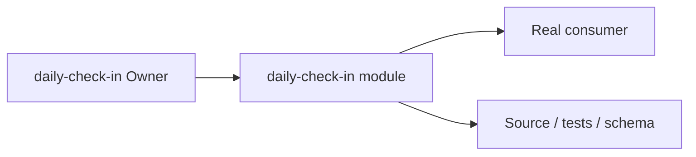
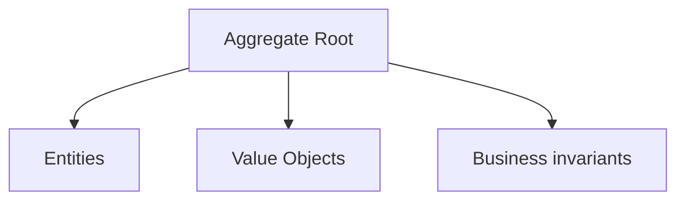
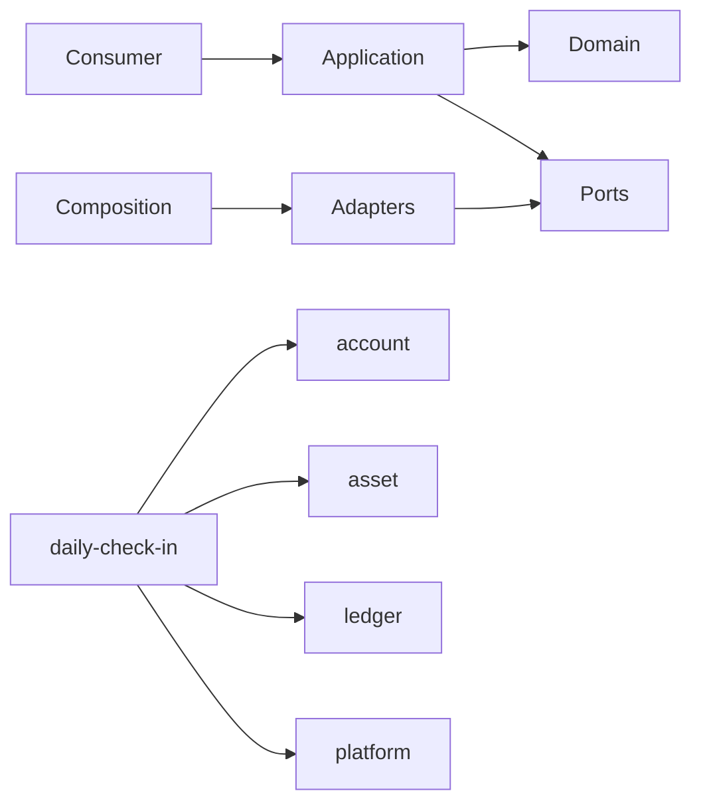

# daily-check-in Owner Architecture

<!-- Generated from package.json and architecture/modules/*.json. -->

## Context Card

| Field | Value |
| --- | --- |
| Owner | daily-check-in |
| Module | @line_bot_v1/daily-check-in |
| Kind | domain-module |

## Context Boundary

## Domain Model

## Boundary and Dependencies

## Key Invariants

- Domain invariants remain owned here.
- Authorization, isolation, replay, and version rules fail closed.

## Public Surface

- ./application/daily-check-in
- ./composition/bootstrap/postgres-daily-check-in-store
- ./domain/error

## Evidence

- [Manifest](./package.json)
- [Source](./src/)
- [Tests](./test/)
- [Module topology](../../architecture/modules/daily-check-in.json)

