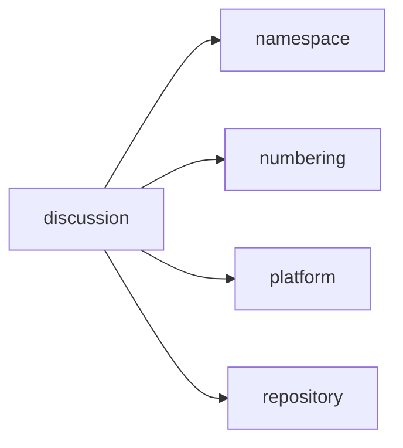
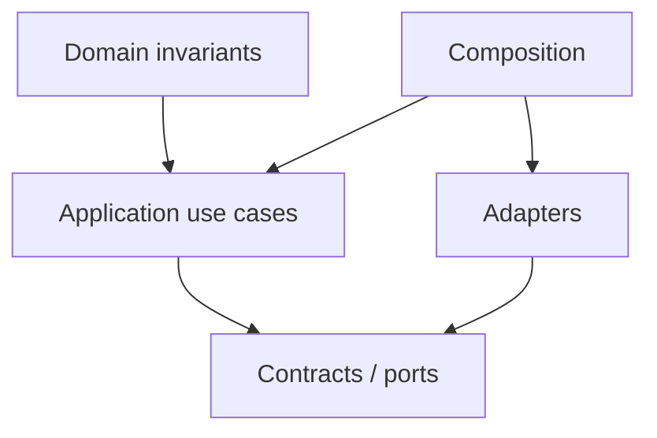

# discussion Owner Architecture

<!-- Generated from package.json and architecture/modules/*.json. -->

| Field | Value |
| --- | --- |
| Package module | @line_bot_v1/discussion |
| semanticOwner | discussion |
| moduleKind | domain-module |

## Boundary and dependencies

## Domain boundary

## Public surface

- ./application/discussions
- ./application/management
- ./contracts/discussions
- ./contracts/management
- ./domain
- ./postgres
- ./postgres/management

## Evidence

- [Manifest](./package.json)
- [Source](./src/)
- [Tests](./test/)
- [Module topology](../../architecture/modules/discussion.json)

