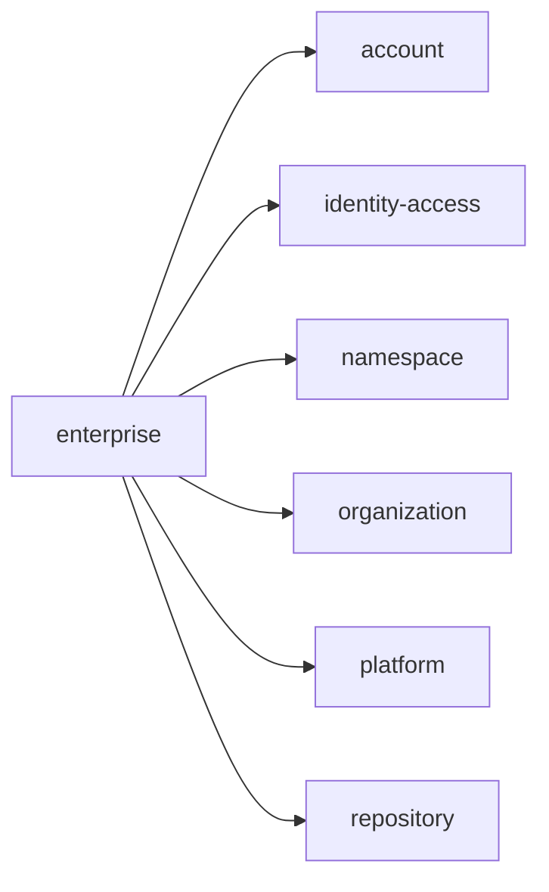
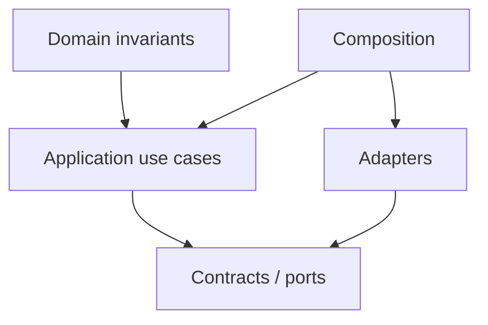

# enterprise Owner Architecture

<!-- Generated from package.json and architecture/modules/*.json. -->

| Field | Value |
| --- | --- |
| Package module | @line_bot_v1/enterprise |
| semanticOwner | enterprise |
| moduleKind | domain-module |

## Boundary and dependencies

## Domain boundary

## Public surface

- ./application/commands/enterprise-lifecycle
- ./application/enterprise-governance
- ./composition/bootstrap/enterprise-governance
- ./contracts/enterprise-governance
- ./contracts/input/enterprise-governance
- ./domain

## Evidence

- [Manifest](./package.json)
- [Source](./src/)
- [Tests](./test/)
- [Module topology](../../architecture/modules/enterprise.json)

