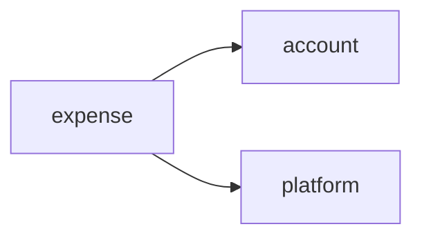
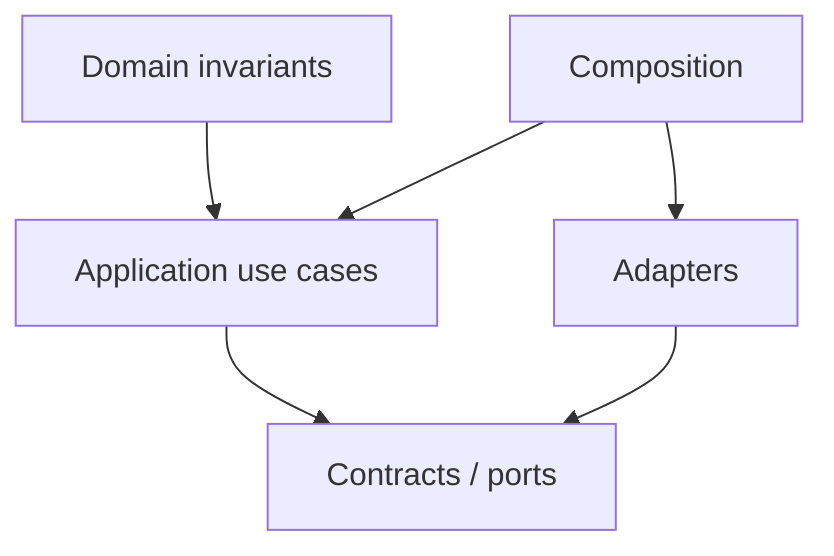

# expense Owner Architecture

<!-- Generated from package.json and architecture/modules/*.json. -->

| Field | Value |
| --- | --- |
| Package module | @line_bot_v1/expense |
| semanticOwner | expense |
| moduleKind | domain-module |

## Boundary and dependencies

## Domain boundary

## Public surface

- ./application/command-expense
- ./application/get-expense
- ./application/receipt-intake
- ./application/recognize-receipt
- ./composition/bootstrap/postgres-expense-store
- ./composition/bootstrap/receipt-recognizer
- ./contracts/dto/expense-api-view
- ./contracts/dto/expense-failure
- ./domain/aggregates/expense

## Evidence

- [Manifest](./package.json)
- [Source](./src/)
- [Tests](./test/)
- [Module topology](../../architecture/modules/expense.json)

