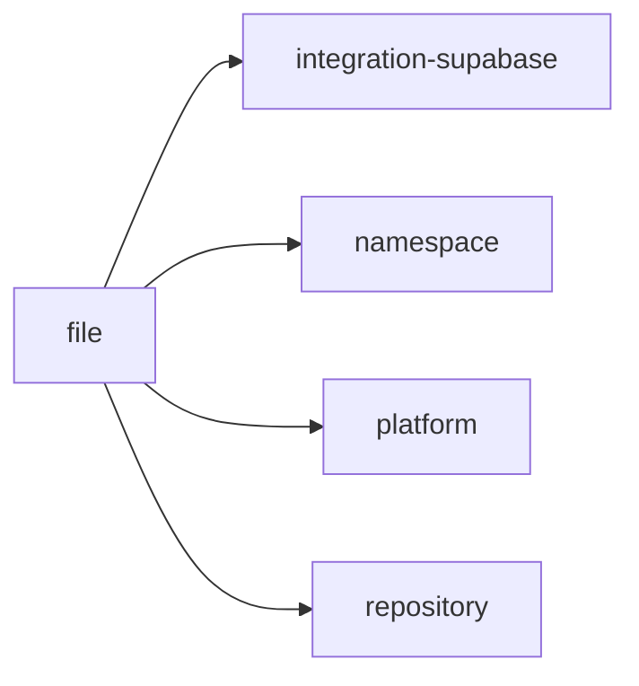
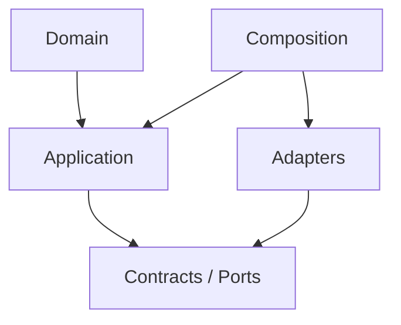

# file Owner Architecture

<!-- Generated from package.json and architecture/modules/*.json. -->

| Field | Value |
| --- | --- |
| Package module | @line_bot_v1/file |
| semanticOwner | file |
| moduleKind | domain-module |

## Boundary and dependencies

## Hexagonal placement

## Public surface

- ./application/use-cases/files
- ./application/use-cases/reclaim
- ./composition/bootstrap/files
- ./contracts/output/references
- ./domain/error
- ./domain/file

## Evidence

- [Manifest](./package.json)
- [Source](./src/)
- [Tests](./test/)
- [Module topology](../../architecture/modules/file.json)

