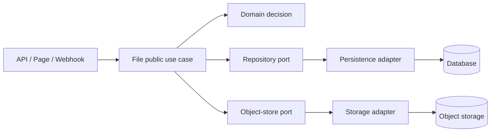

# File 模組

File 是檔案原始內容、版本、來源資格、儲存與回收流程的唯一業務 Owner。所有 File business decision 必須集中在本 package；API、Page、Webhook 只能解析輸入、建立 command/query、呼叫公開入口並格式化輸出。

## 必須遵守的規則

- Domain 只表達 File 不變條件與狀態轉移，不依賴框架、HTTP、SQL、Supabase 或 UI。
- Application use case 負責協調 domain、port、交易與授權上下文；不得把業務決策搬到 route/page。
- Outbound adapter 實作 port，不能反向讓 domain/application import provider SDK。
- 跨 package 只使用 [manifest exports](./package.json)；不得引用 `src` 私有路徑。
- 原始檔識別與解析結果必須分開；來源讀取與資格檢查依 [references contract](./src/contracts/output/references.ts) 執行。
- 不重複讀取 bytes、不在記憶體複製整個 payload、不以同步 loop 取代可恢復的串流或批次流程。

## If / Then 決策規則

| If | Then |
| --- | --- |
| 需求改變檔案狀態或資格 | 先修改 `src/domain` 與 application contract，再由 adapter 接入。 |
| 需求只是 HTTP、Page 或 LINE 輸入輸出 | 保持 presentation 薄層，只呼叫 package 公開 use case。 |
| 需要資料庫、物件儲存或外部來源 | 先定義/確認 port，再在 `src/adapters/outbound` 實作。 |
| 來源無法讀取、資格不符或版本不一致 | 回傳具名 domain/application error；不得以 `null` 或空結果掩蓋原因。 |
| 變更涉及公開 export、資料、授權、replay 或 recovery | 同步更新 tests、architecture evidence 與相關 migration 文件。 |

## 目錄責任

```text
packages/file/
├── src/domain/                 # File entity、value、invariant、domain error
├── src/application/            # commands、queries、use cases、協調流程
├── src/contracts/              # inbound/outbound port 與 DTO contract
├── src/adapters/outbound/      # persistence、object storage、binary payload adapter
└── src/composition/bootstrap/  # 唯一組裝 concrete adapter 的位置
```



## 公開入口與驗證

| 能力 | 公開入口 | 驗證 |
| --- | --- | --- |
| 建立/取得 File | `application/use-cases/files` | `pnpm --filter @line_bot_v1/file test` |
| 回收或清理 | `application/use-cases/reclaim` | 同上，另驗證 isolation/replay |
| 來源讀取與資格 | `contracts/output/references`、`application/use-cases/sources` | source 與 references consumers 測試 |
| 組裝 runtime | `composition/bootstrap/files` | package typecheck + integration tests |

```sh
pnpm --filter @line_bot_v1/file typecheck
pnpm --filter @line_bot_v1/file test
pnpm check:repository
```

## 變更檢查清單

- [ ] owner、consumer、port 與資料責任已定位。
- [ ] route/page 沒有新增 File business logic。
- [ ] public exports、測試與文件連結同步。
- [ ] bytes、revision、receipt 的 immutable/replay/isolation 條件仍成立。
- [ ] 執行受影響 package 驗證並記錄結果。

更多術語見 [SEMANTICS](./SEMANTICS.md)、Owner 路由見 [docs/owners/file.md](../../docs/owners/file.md)。
