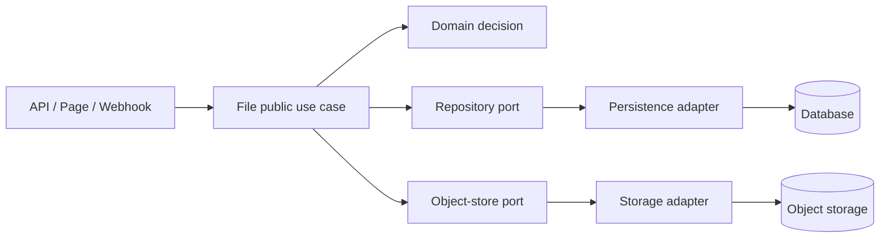

# File 模組

File 是檔案原始內容、版本、來源資格、儲存與回收流程的唯一業務 Owner。所有 File business decision 必須集中在本 package；API、Page、Webhook 只能解析輸入、建立 command/query、呼叫公開入口並格式化輸出。

## 必須遵守的規則

- Domain 只表達 File 不變條件與狀態轉移，不依賴框架、HTTP、SQL、Supabase 或 UI。
- Application use case 負責協調 domain、port、交易與授權上下文；不得把業務決策搬到 route/page。
- Outbound adapter 實作 port，不能反向讓 domain/application import provider SDK。
- 跨 package 只使用 [manifest exports](./package.json)；不得引用 `src` 私有路徑。
- 原始檔識別與解析結果必須分開；來源讀取與資格檢查依 [references contract](./src/contracts/output/references.ts) 執行。
- 不重複讀取 bytes、不在記憶體複製整個 payload、不以同步 loop 取代可恢復的串流或批次流程。

## Web 快路徑

- Web 只透過受身分及 Repository 範圍保護的 JSON `prepare-upload`／`complete-upload` 指令寫 File。
- 檔案 Binary 直接 PUT 到私有 Storage 的不可覆寫 Signed Upload URL；它是短效寫入能力，**不是** File Revision 提交授權。
- File 使用現有持久 Upload Intent、Request ID 與期望版本，完成後必須讀回 Storage 驗證長度與 SHA-256，再於資料庫原子提交 Revision、Head、Receipt。
- 未完成或不確定的 PUT 保留原 Intent，重試以相同 Request ID 與來源指紋恢復；長期未完成交由受信任 Reclaimer 清理。
- Web 單次上傳／下載限定 3 MB；CLI 與下游 File source 保留原本 45 MiB 能力。Web 下載保留讀取前後的授權檢查，不簽發撤權後仍可使用的下載 URL。

## If / Then 決策規則

| If | Then |
| --- | --- |
| 需求改變檔案狀態或資格 | 先修改 `src/domain` 與 application contract，再由 adapter 接入。 |
| 需求只是 HTTP、Page 或 LINE 輸入輸出 | 保持 presentation 薄層，只呼叫 package 公開 use case。 |
| 需要資料庫、物件儲存或外部來源 | 先定義/確認 port，再在 `src/adapters/outbound` 實作。 |
| 來源無法讀取、資格不符或版本不一致 | 回傳具名 domain/application error；不得以 `null` 或空結果掩蓋原因。 |
| 變更涉及公開 export、資料、授權、replay 或 recovery | 同步更新 tests、architecture evidence 與相關 migration 文件。 |

## 目錄責任

```text
packages/file/
├── src/domain/                 # File entity、value、invariant、domain error
├── src/application/            # File Application 查詢、Upload Intent／Finalize、來源資格等 Use Cases
├── src/contracts/              # 查詢／交易／Storage／來源 Port
├── src/adapters/inbound/       # File HTTP 指令／查詢轉譯（Web 標準 Request/Response，無 Next.js）
├── src/adapters/outbound/      # PostgreSQL File 讀寫、operator-only Reclamation、Storage
└── src/composition/bootstrap/  # 唯一組裝 concrete adapter 的位置
```



## 高內聚責任與依賴方向

- `application/use-cases/files.ts` 是唯一且有真實 Consumer 的 File Application 入口，同一檔案依 Use Case 組織查詢、Upload Intent、Storage I/O 及 Finalize；不再保留只負責轉發的查詢／上傳 Factory。
- `adapters/inbound/http.ts` 擁有 File 的 Web-standard query/command dispatch、限流與傳輸回應；`apps/web/src/app/api/_composition/files-request.server.ts` 負責 LINE 身分、Repository locator、Origin 與 host 錯誤投影；`modules/file` 僅管前端 UI。
- `adapters/outbound/persistence/files.ts` 擁有正常 File Metadata 與交易；`reclamation.ts` 是 operator-only capability，Web Composition 不可取得回收權限。
- Browser Signed Upload、File View Projection、採購單的 ContractDocument 審核工作流程，保留在對應 `apps/web/src/modules/file` presentation 檔案；ContractDocument 的正式寫入仍由 Contract Owner 核准。
- `apps/web/src/app/api/repository-files/route.ts` 不可取得 PostgreSQL／Storage SDK 或自行管理 File Domain 狀態。

## 公開入口與驗證

| 能力 | 公開入口 | 驗證 |
| --- | --- | --- |
| File HTTP Inbound Adapter | `adapters/inbound/http` | Web HTTP 與 3 MB 傳輸測試 |
| 建立/取得 File | `application/use-cases/files` | `pnpm --filter @line_bot_v1/file test` |
| 回收或清理 | `application/use-cases/reclaim` | 同上，另驗證 isolation/replay |
| 來源讀取與資格 | `contracts/output/references`、`application/use-cases/sources` | source 與 references consumers 測試 |
| 組裝 runtime | `composition/bootstrap/files` | package typecheck + integration tests |

```sh
pnpm --filter @line_bot_v1/file typecheck
pnpm --filter @line_bot_v1/file test
pnpm check:repository
```

## 變更檢查清單

- [ ] owner、consumer、port 與資料責任已定位。
- [ ] route/page 沒有新增 File business logic。
- [ ] public exports、測試與文件連結同步。
- [ ] bytes、revision、receipt 的 immutable/replay/isolation 條件仍成立。
- [ ] 執行受影響 package 驗證並記錄結果。

更多術語見 [SEMANTICS](./SEMANTICS.md)、Owner 路由見 [docs/owners/file.md](../../docs/owners/file.md)。
