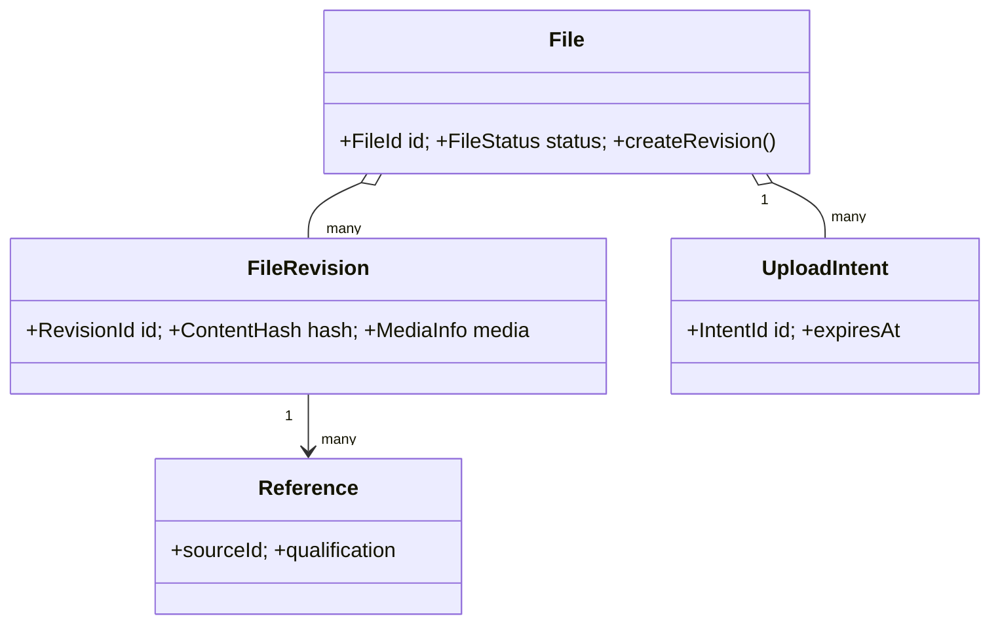

# File 語意與 AI 規則

## 短規則

- `File` 是穩定的業務資源，不等於上傳請求、二進位 payload 或解析結果。
- `FileRevision` 是原始檔案某一版本的不可變識別、媒體資訊與雜湊。
- `UploadIntent` 描述即將發生的寫入意圖；不得把它當成已成功保存的 File。
- `Reference` 描述來源與資格；原始識別和解析結果分開保存。

## If / Then

- If 只改 metadata，Then 不重新上傳或複製 payload。
- If content hash 相同，Then 重用已驗證 revision；除非 contract 明確要求新 revision。
- If hash、size、media type 或來源 pin 不一致，Then 拒絕操作並保留可診斷錯誤。
- If adapter 失敗，Then 由 application 決定 retry/recovery；domain 不直接重試 provider。

## Domain 類別關係



## 結構化語意

```yaml
owner: file
boundaries:
  domain: [file, revision, upload_intent, reference]
  application: [commands, queries, source_qualification, reclaim]
  adapters: [persistence, object_store, binary_payload]
invariants:
  - original_bytes_are_immutable_after_revision_creation
  - file_processing_runs_belong_to_intelligence
  - replay_identity_isolated_by_repository_actor_namespace
  - source_identity_is_separate_from_parsed_result
```

公開能力與實際 exports 以 [package.json](./package.json) 為準；行為以 [source](./src/) 與 [tests](./test/) 為準。
