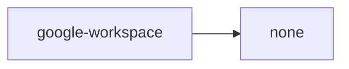
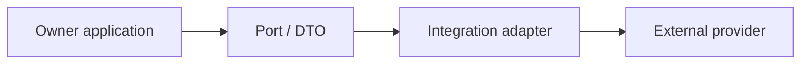

# google-workspace Owner Architecture

<!-- Generated from package.json and architecture/modules/*.json. -->

| Field | Value |
| --- | --- |
| Package module | @line_bot_v1/google-workspace |
| semanticOwner | google-workspace |
| moduleKind | integration-adapter |

## Boundary and dependencies

## Integration boundary

## Public surface

- ./calendar
- ./docs
- ./drive
- ./forms
- ./gmail
- ./keep
- ./maps
- ./sheets
- ./tasks

## Evidence

- [Manifest](./package.json)
- [Source](./src/)
- [Tests](./test/)
- [Module topology](../../architecture/modules/google-workspace.json)

