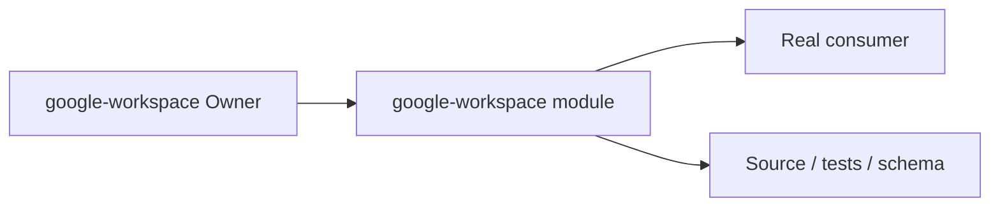
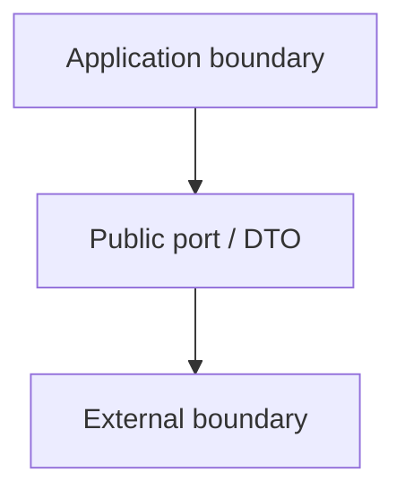
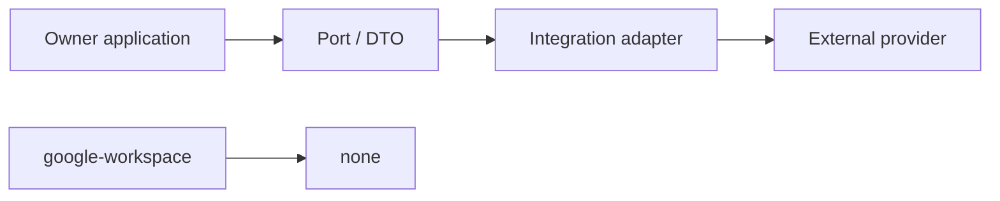

# google-workspace Owner Architecture

<!-- Generated from package.json and architecture/modules/*.json. -->

## Context Card

| Field | Value |
| --- | --- |
| Owner | google-workspace |
| Module | @line_bot_v1/google-workspace |
| Kind | integration-adapter |

## Context Boundary

## Domain Model

## Boundary and Dependencies

## Key Invariants

- This module does not acquire another Owner's business authority.
- Boundary errors remain explicit and evidence-backed.

## Public Surface

- ./calendar
- ./docs
- ./drive
- ./forms
- ./gmail
- ./keep
- ./maps
- ./sheets
- ./tasks

## Evidence

- [Manifest](./package.json)
- [Source](./src/)
- [Tests](./test/)
- [Module topology](../../architecture/modules/google-workspace.json)

