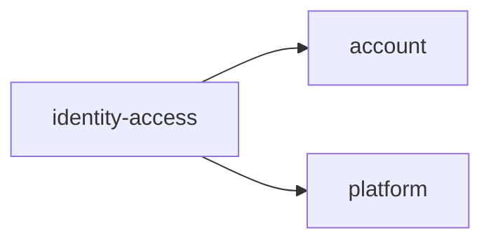
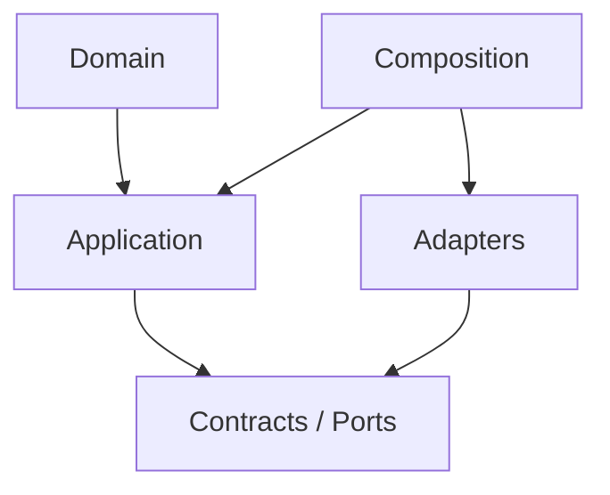

# identity-access Owner Architecture

<!-- Generated from package.json and architecture/modules/*.json. -->

| Field | Value |
| --- | --- |
| Package module | @line_bot_v1/identity-access |
| semanticOwner | identity-access |
| moduleKind | domain-module |

## Boundary and dependencies

## Hexagonal placement

## Public surface

- ./application/permissions
- ./contracts/audit
- ./contracts/governance
- ./contracts/permissions
- ./domain/permission
- ./domain/role-assignment
- ./postgres
- ./postgres/audit

## Evidence

- [Manifest](./package.json)
- [Source](./src/)
- [Tests](./test/)
- [Module topology](../../architecture/modules/identity-access.json)

