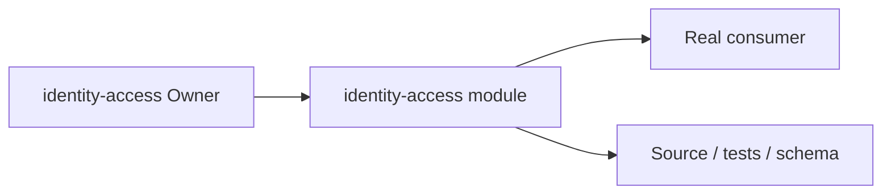
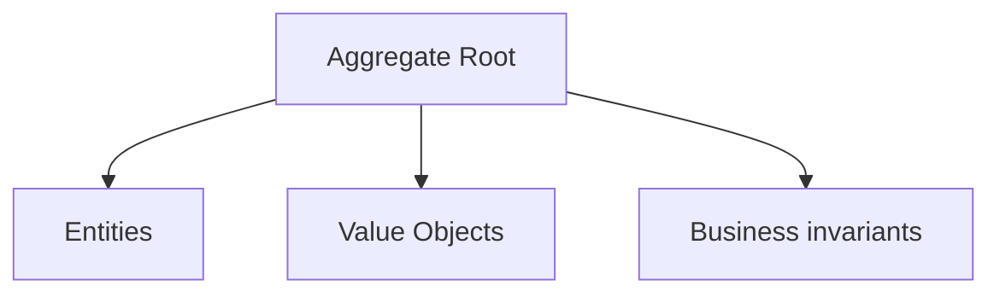
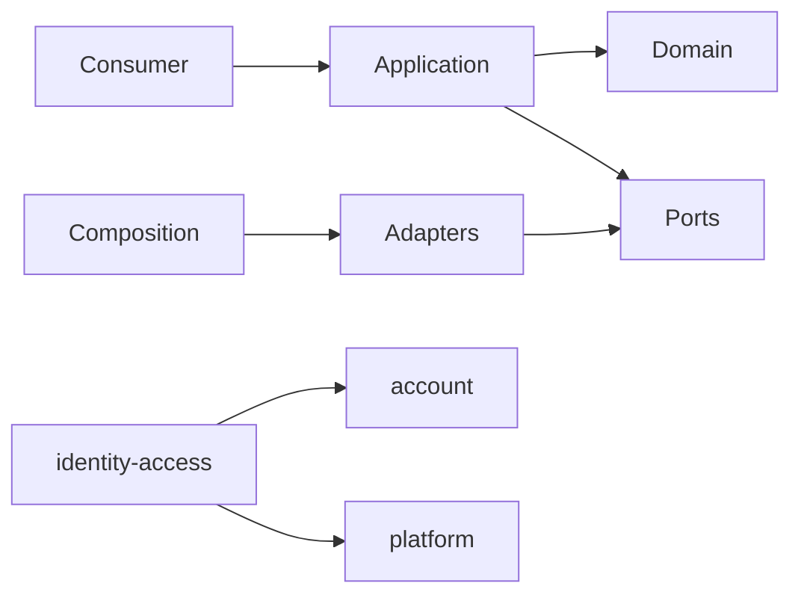

# identity-access Owner Architecture

<!-- Generated from package.json and architecture/modules/*.json. -->

## Context Card

| Field | Value |
| --- | --- |
| Owner | identity-access |
| Module | @line_bot_v1/identity-access |
| Kind | domain-module |

## Implementation Status

| Area | Status |
| --- | --- |
| domain | present |
| application | present |
| contracts | present |
| adapters | present |
| composition | present |
| test | present |

## Context Boundary

## Domain Model

## Boundary and Dependencies

## Key Invariants

- Domain invariants remain owned here.
- Authorization, isolation, replay, and version rules fail closed.

## Public Surface

- ./application/permissions
- ./contracts/audit
- ./contracts/governance
- ./contracts/permissions
- ./domain/permission
- ./domain/role-assignment
- ./postgres
- ./postgres/audit

## Evidence

- [Manifest](./package.json)
- [Source](./src/)
- [Tests](./test/)
- [Module topology](../../architecture/modules/identity-access.json)

