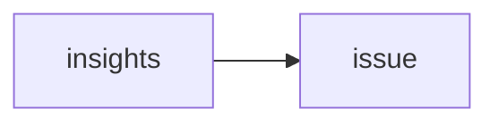
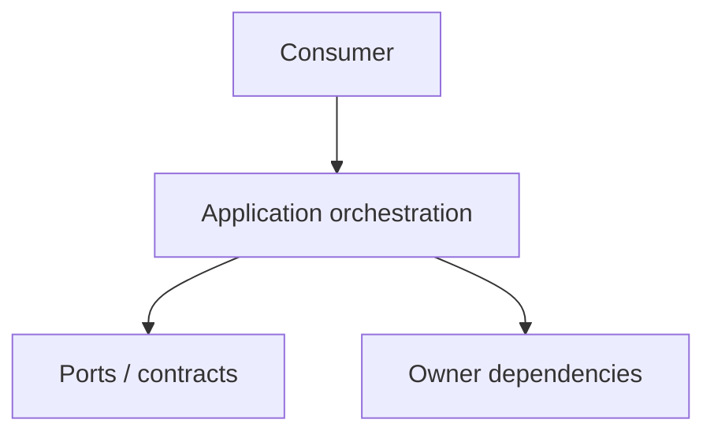

# insights Owner Architecture

<!-- Generated from package.json and architecture/modules/*.json. -->

| Field | Value |
| --- | --- |
| Package module | @line_bot_v1/insights |
| semanticOwner | insights |
| moduleKind | application-module |

## Boundary and dependencies

## Application boundary

## Public surface

- ./application/use-cases/repository-pulse
- ./contracts/dto/repository-pulse

## Evidence

- [Manifest](./package.json)
- [Source](./src/)
- [Tests](./test/)
- [Module topology](../../architecture/modules/insights.json)

