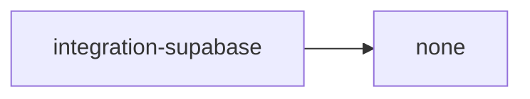
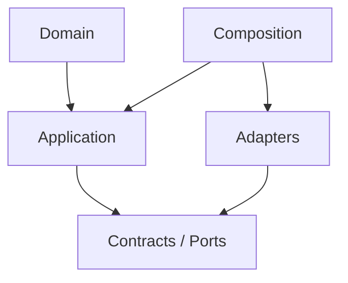

# integration-supabase Owner Architecture

<!-- Generated from package.json and architecture/modules/*.json. -->

| Field | Value |
| --- | --- |
| Package module | @line_bot_v1/integration-supabase |
| semanticOwner | supabase-integration |
| moduleKind | integration-adapter |

## Boundary and dependencies

## Hexagonal placement

## Public surface

- ./storage-client

## Evidence

- [Manifest](./package.json)
- [Source](./src/)
- [Tests](./test/)
- [Module topology](../../architecture/modules/integration-supabase.json)

