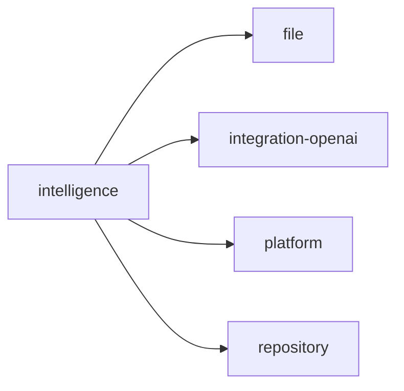
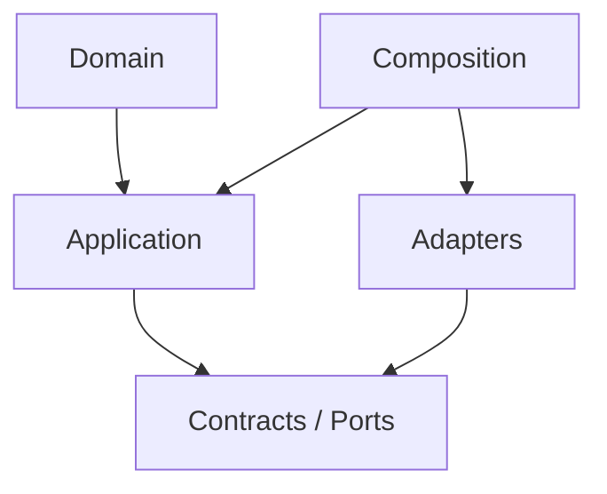

# intelligence Owner Architecture

<!-- Generated from package.json and architecture/modules/*.json. -->

| Field | Value |
| --- | --- |
| Package module | @line_bot_v1/intelligence |
| semanticOwner | intelligence |
| moduleKind | application-module |

## Boundary and dependencies

## Hexagonal placement

## Public surface

- ./composition/bootstrap/commercial-intake
- ./composition/bootstrap/document-intake
- ./contracts/output/commercial-intake
- ./contracts/output/document-intake
- ./contracts/output/processing
- ./domain/error

## Evidence

- [Manifest](./package.json)
- [Source](./src/)
- [Tests](./test/)
- [Module topology](../../architecture/modules/intelligence.json)

