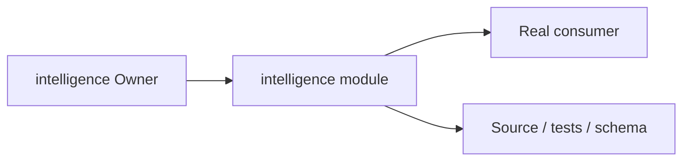
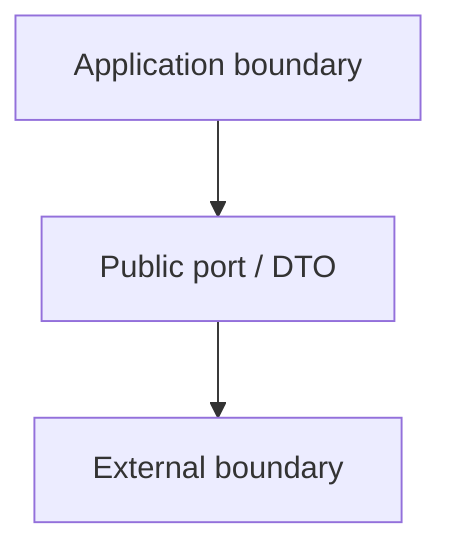
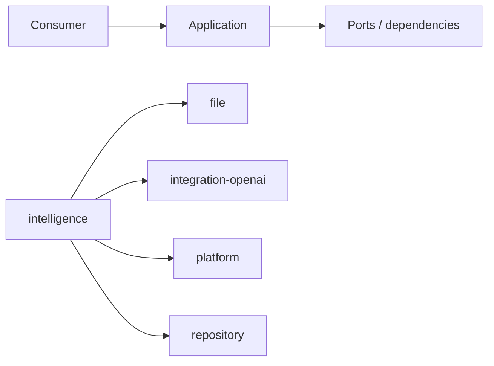

# intelligence Owner Architecture

<!-- Generated from package.json and architecture/modules/*.json. -->

## Context Card

| Field | Value |
| --- | --- |
| Owner | intelligence |
| Module | @line_bot_v1/intelligence |
| Kind | application-module |

## Implementation Status

| Area | Status |
| --- | --- |
| domain | present |
| application | present |
| contracts | present |
| adapters | present |
| composition | present |
| test | present |

## Context Boundary

## Domain Model

## Boundary and Dependencies

## Key Invariants

- This module does not acquire another Owner's business authority.
- Boundary errors remain explicit and evidence-backed.

## Public Surface

- ./composition/bootstrap/commercial-intake
- ./composition/bootstrap/document-intake
- ./contracts/output/commercial-intake
- ./contracts/output/document-intake
- ./contracts/output/processing
- ./domain/error

## Evidence

- [Manifest](./package.json)
- [Source](./src/)
- [Tests](./test/)
- [Module topology](../../architecture/modules/intelligence.json)

