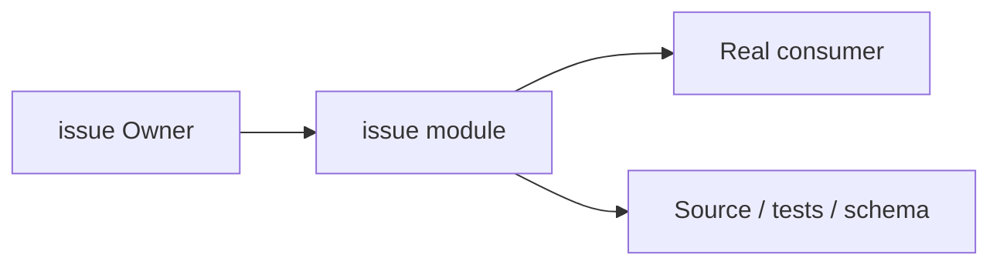
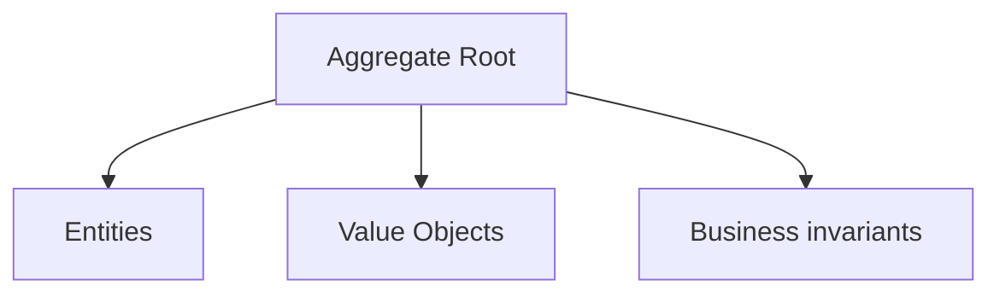
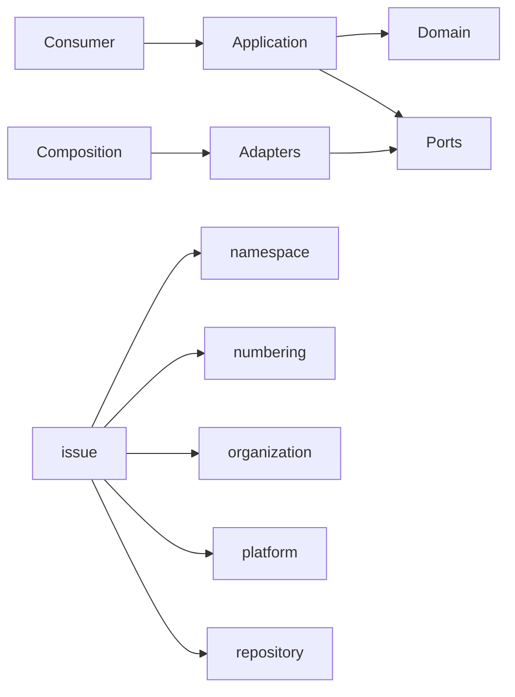

# issue Owner Architecture

<!-- Generated from package.json and architecture/modules/*.json. -->

## Context Card

| Field | Value |
| --- | --- |
| Owner | issue |
| Module | @line_bot_v1/issue |
| Kind | domain-module |

## Implementation Status

| Area | Status |
| --- | --- |
| domain | present |
| application | present |
| contracts | present |
| adapters | present |
| composition | present |
| test | present |

## Context Boundary

## Domain Model

## Boundary and Dependencies

## Key Invariants

- Domain invariants remain owned here.
- Authorization, isolation, replay, and version rules fail closed.

## Public Surface

- ./application/activity
- ./application/collaboration
- ./application/issue-types
- ./application/issues
- ./composition/bootstrap/collaboration
- ./composition/bootstrap/metrics
- ./contracts/activity
- ./contracts/collaboration
- ./contracts/input/issues
- ./contracts/issue-types
- ./contracts/output/metrics
- ./contracts/repositories/issues
- ./domain
- ./postgres
- ./postgres/activity
- ./postgres/issue-types
- ./postgres/project-reference

## Evidence

- [Manifest](./package.json)
- [Source](./src/)
- [Tests](./test/)
- [Module topology](../../architecture/modules/issue.json)

