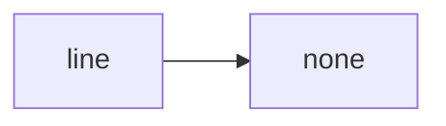
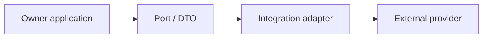

# line Owner Architecture

<!-- Generated from package.json and architecture/modules/*.json. -->

| Field | Value |
| --- | --- |
| Package module | @line_bot_v1/line |
| semanticOwner | line-integration |
| moduleKind | integration-adapter |

## Boundary and dependencies

## Integration boundary

## Public surface

- ./identity
- ./liff
- ./messaging-api
- ./mini-app
- ./provider
- ./rich-menu

## Evidence

- [Manifest](./package.json)
- [Source](./src/)
- [Tests](./test/)
- [Module topology](../../architecture/modules/line.json)

