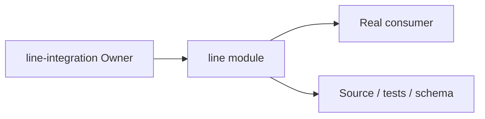
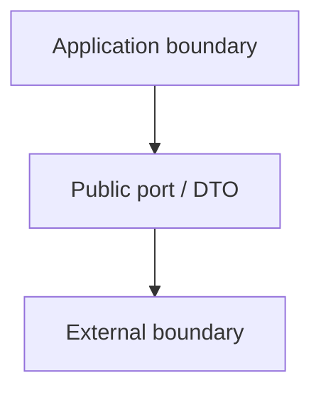
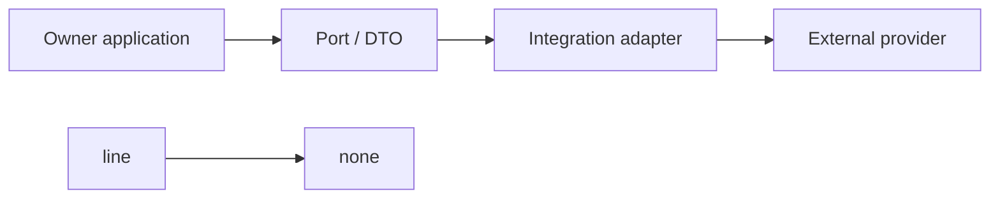

# line Owner Architecture

<!-- Generated from package.json and architecture/modules/*.json. -->

## Context Card

| Field | Value |
| --- | --- |
| Owner | line-integration |
| Module | @line_bot_v1/line |
| Kind | integration-adapter |

## Implementation Status

| Area | Status |
| --- | --- |
| domain | not-applicable |
| application | not-applicable |
| contracts | not-applicable |
| adapters | required-but-missing |
| composition | not-applicable |
| test | present |

## Context Boundary

## Domain Model

## Boundary and Dependencies

## Key Invariants

- This module does not acquire another Owner's business authority.
- Boundary errors remain explicit and evidence-backed.

## Public Surface

- ./identity
- ./liff
- ./messaging-api
- ./mini-app
- ./provider
- ./rich-menu

## Evidence

- [Manifest](./package.json)
- [Source](./src/)
- [Tests](./test/)
- [Module topology](../../architecture/modules/line.json)

