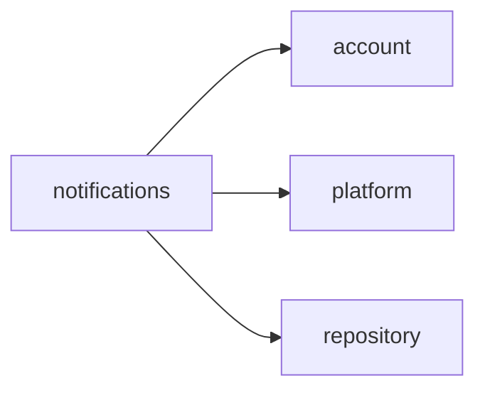
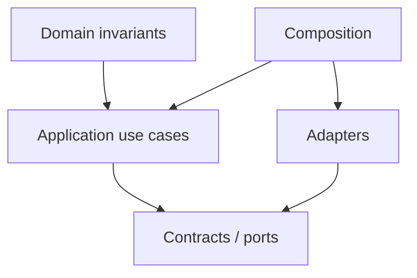

# notifications Owner Architecture

<!-- Generated from package.json and architecture/modules/*.json. -->

| Field | Value |
| --- | --- |
| Package module | @line_bot_v1/notifications |
| semanticOwner | notifications |
| moduleKind | domain-module |

## Boundary and dependencies

## Domain boundary

## Public surface

- ./application/use-cases/baseline-delivery
- ./application/use-cases/notifications
- ./application/use-cases/project-baseline-delivery
- ./composition/bootstrap/baseline-delivery
- ./composition/bootstrap/postgres-notification-repository
- ./composition/bootstrap/project-baseline-delivery
- ./composition/bootstrap/transfer-facts
- ./contracts/dto/notification
- ./contracts/output/baseline-delivery
- ./contracts/output/project-baseline-delivery
- ./contracts/repositories/baseline-delivery
- ./contracts/repositories/notification-repository
- ./contracts/repositories/project-baseline-delivery
- ./domain/error
- ./domain/value-objects/notification-id
- ./domain/value-objects/notification-kind

## Evidence

- [Manifest](./package.json)
- [Source](./src/)
- [Tests](./test/)
- [Module topology](../../architecture/modules/notifications.json)

