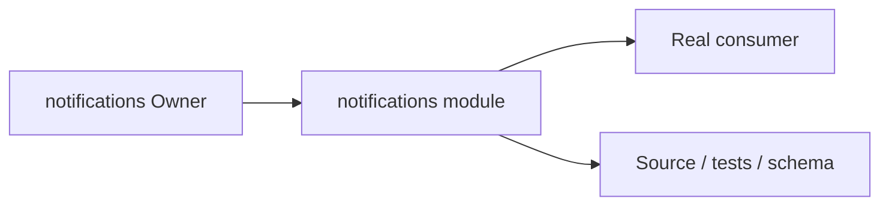
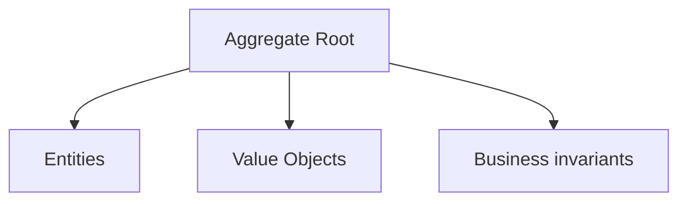
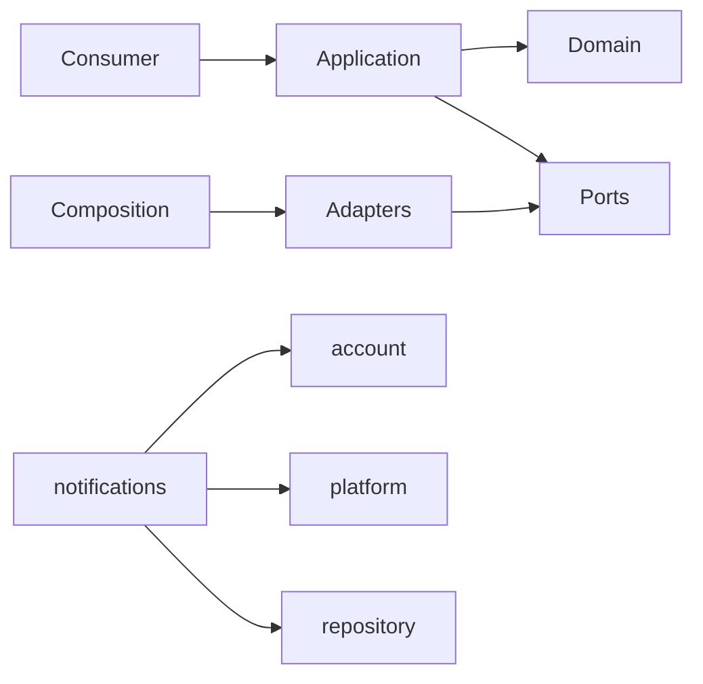

# notifications Owner Architecture

<!-- Generated from package.json and architecture/modules/*.json. -->

## Context Card

| Field | Value |
| --- | --- |
| Owner | notifications |
| Module | @line_bot_v1/notifications |
| Kind | domain-module |

## Implementation Status

| Area | Status |
| --- | --- |
| domain | present |
| application | present |
| contracts | present |
| adapters | present |
| composition | present |
| test | present |

## Context Boundary

## Domain Model

## Boundary and Dependencies

## Key Invariants

- Domain invariants remain owned here.
- Authorization, isolation, replay, and version rules fail closed.

## Public Surface

- ./application/use-cases/baseline-delivery
- ./application/use-cases/notifications
- ./application/use-cases/project-baseline-delivery
- ./composition/bootstrap/baseline-delivery
- ./composition/bootstrap/postgres-notification-repository
- ./composition/bootstrap/project-baseline-delivery
- ./composition/bootstrap/transfer-facts
- ./contracts/dto/notification
- ./contracts/output/baseline-delivery
- ./contracts/output/project-baseline-delivery
- ./contracts/repositories/baseline-delivery
- ./contracts/repositories/notification-repository
- ./contracts/repositories/project-baseline-delivery
- ./domain/error
- ./domain/value-objects/notification-id
- ./domain/value-objects/notification-kind

## Evidence

- [Manifest](./package.json)
- [Source](./src/)
- [Tests](./test/)
- [Module topology](../../architecture/modules/notifications.json)

