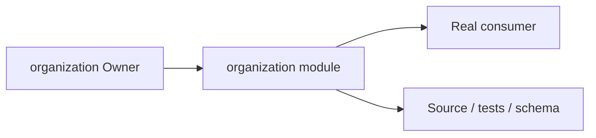
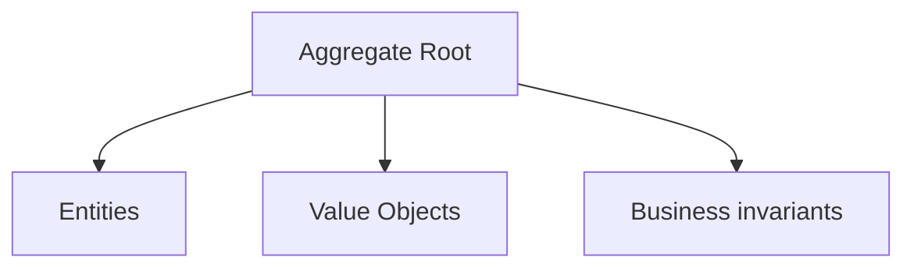
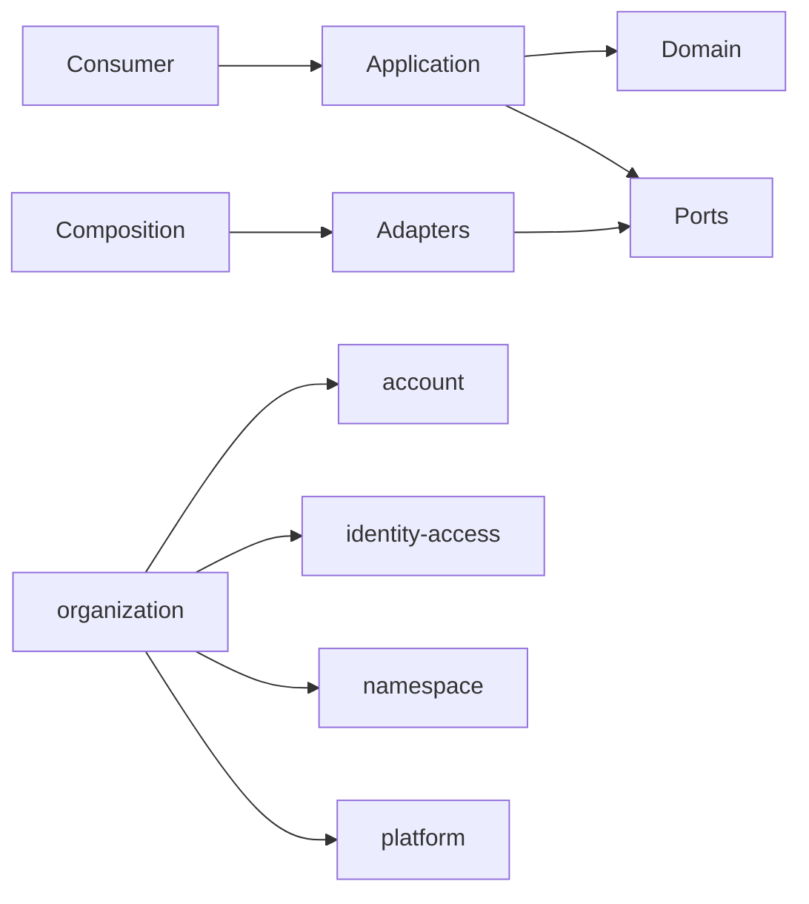

# organization Owner Architecture

<!-- Generated from package.json and architecture/modules/*.json. -->

## Context Card

| Field | Value |
| --- | --- |
| Owner | organization |
| Module | @line_bot_v1/organization |
| Kind | domain-module |

## Implementation Status

| Area | Status |
| --- | --- |
| domain | required-but-missing |
| application | present |
| contracts | present |
| adapters | present |
| composition | present |
| test | present |

## Context Boundary

## Domain Model

## Boundary and Dependencies

## Key Invariants

- Domain invariants remain owned here.
- Authorization, isolation, replay, and version rules fail closed.

## Public Surface

- ./application/commands/organization-lifecycle
- ./application/organization-governance
- ./application/public
- ./composition/bootstrap/organization-governance
- ./contracts/input/organization-governance
- ./contracts/organization-governance
- ./contracts/output/public
- ./domain
- ./postgres
- ./postgres/public

## Evidence

- [Manifest](./package.json)
- [Source](./src/)
- [Tests](./test/)
- [Module topology](../../architecture/modules/organization.json)

