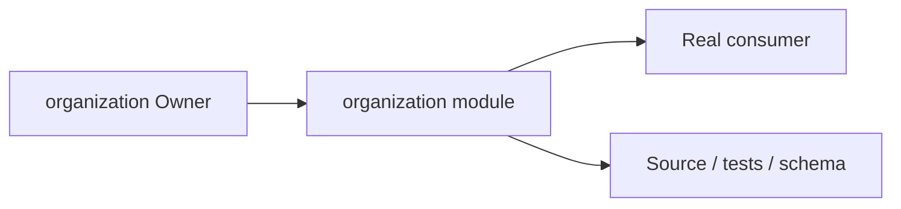
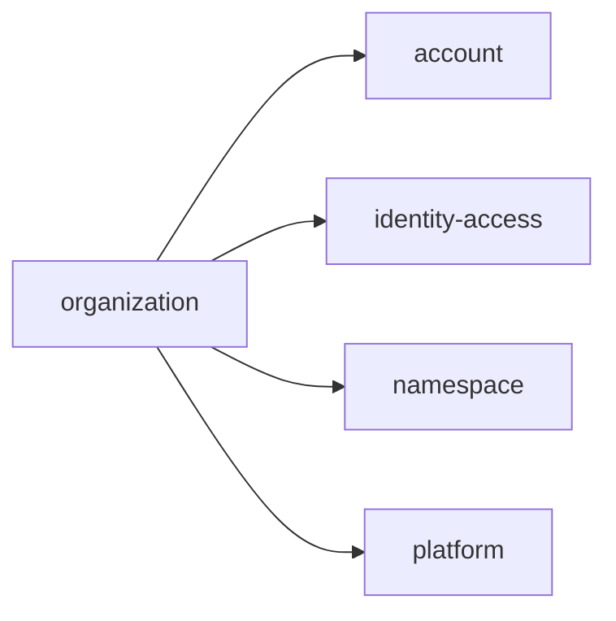
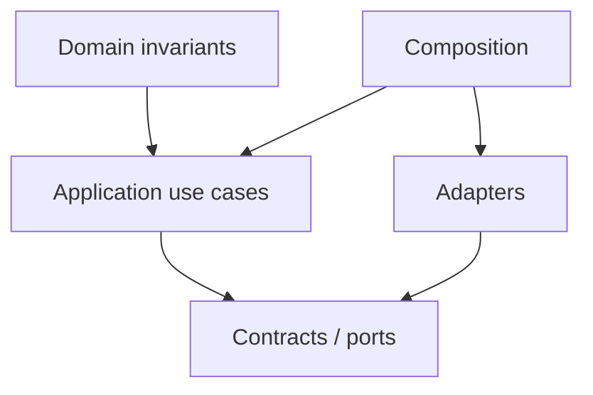
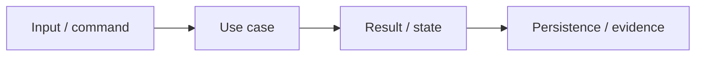

# organization Owner Architecture

<!-- Generated from package.json and architecture/modules/*.json. -->

| Field | Value |
| --- | --- |
| Package module | @line_bot_v1/organization |
| semanticOwner | organization |
| moduleKind | domain-module |

## Owner boundary

## Ubiquitous language

| Term | Meaning |
| --- | --- |
| Owner | organization |
| Module kind | domain-module |
| Package role | implementation module mapped through registry topology |

## Dependencies

## Domain boundary

## Invariants

- Domain invariants remain in this Owner.
- Authorization, isolation, replay, and expected-version rules fail closed.

## State and data flow

## Public functions

- ./application/commands/organization-lifecycle
- ./application/organization-governance
- ./application/public
- ./composition/bootstrap/organization-governance
- ./contracts/input/organization-governance
- ./contracts/organization-governance
- ./contracts/output/public
- ./domain
- ./postgres
- ./postgres/public

## Evidence

- [Manifest](./package.json)
- [Source](./src/)
- [Tests](./test/)
- [Module topology](../../architecture/modules/organization.json)

