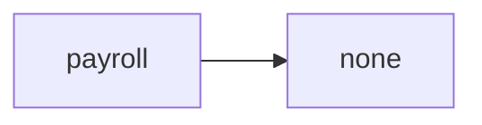
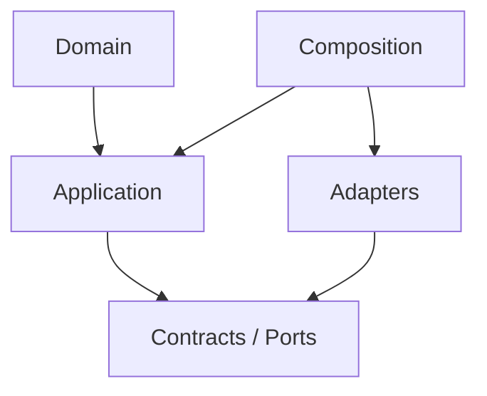

# payroll Owner Architecture

<!-- Generated from package.json and architecture/modules/*.json. -->

| Field | Value |
| --- | --- |
| Package module | @line_bot_v1/payroll |
| semanticOwner | payroll |
| moduleKind | domain-module |

## Boundary and dependencies

## Hexagonal placement

## Public surface

- ./application/readiness
- ./contracts/input/payroll-readiness-query
- ./contracts/output/payroll-readiness-sources
- ./domain/error
- ./domain/policies/payroll-readiness
- ./domain/value-objects/payroll-rule

## Evidence

- [Manifest](./package.json)
- [Source](./src/)
- [Tests](./test/)
- [Module topology](../../architecture/modules/payroll.json)

