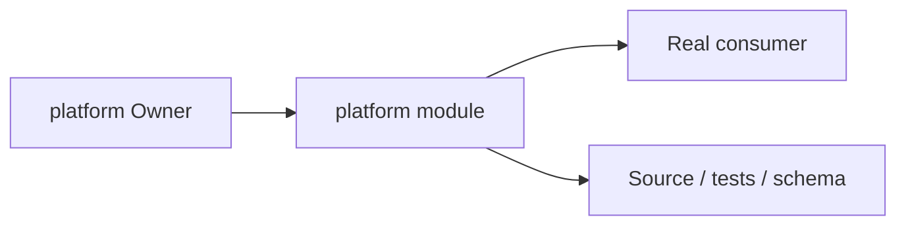
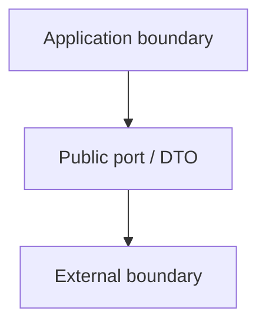
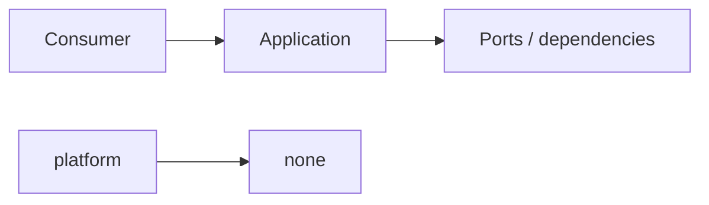

# platform Owner Architecture

<!-- Generated from package.json and architecture/modules/*.json. -->

## Context Card

| Field | Value |
| --- | --- |
| Owner | platform |
| Module | @line_bot_v1/platform |
| Kind | support-module |

## Implementation Status

| Area | Status |
| --- | --- |
| domain | not-applicable |
| application | not-applicable |
| contracts | not-applicable |
| adapters | not-applicable |
| composition | not-applicable |
| test | present |

## Context Boundary

## Domain Model

## Boundary and Dependencies

## Key Invariants

- This module does not acquire another Owner's business authority.
- Boundary errors remain explicit and evidence-backed.

## Public Surface

- ./postgres
- ./redis
- ./testing/postgres
- ./testing/postgres-sessions
- ./text
- ./validation

## Evidence

- [Manifest](./package.json)
- [Source](./src/)
- [Tests](./test/)
- [Module topology](../../architecture/modules/platform.json)

