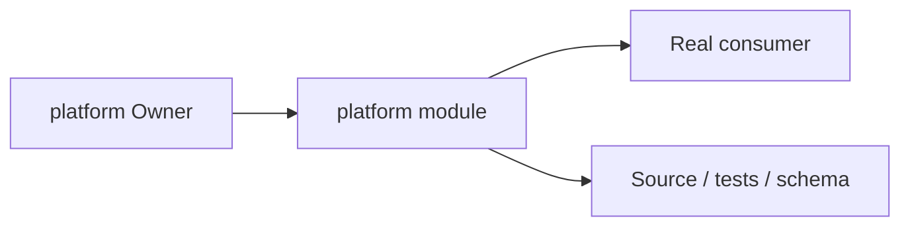
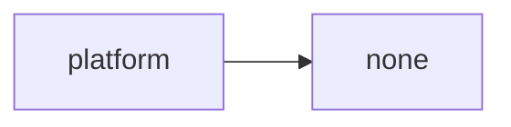
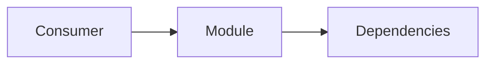
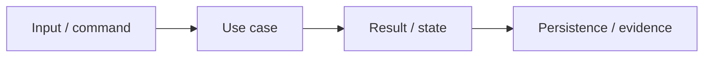

# platform Owner Architecture

<!-- Generated from package.json and architecture/modules/*.json. -->

| Field | Value |
| --- | --- |
| Package module | @line_bot_v1/platform |
| semanticOwner | platform |
| moduleKind | support-module |

## Owner boundary

## Ubiquitous language

| Term | Meaning |
| --- | --- |
| Owner | platform |
| Module kind | support-module |
| Package role | implementation module mapped through registry topology |

## Dependencies

## Module boundary

## Invariants

- Orchestration does not acquire another Owner's business authority.
- Public contracts and evidence remain the compatibility boundary.

## State and data flow

## Public functions

- ./postgres
- ./redis
- ./testing/postgres
- ./testing/postgres-sessions
- ./text
- ./validation

## Evidence

- [Manifest](./package.json)
- [Source](./src/)
- [Tests](./test/)
- [Module topology](../../architecture/modules/platform.json)

