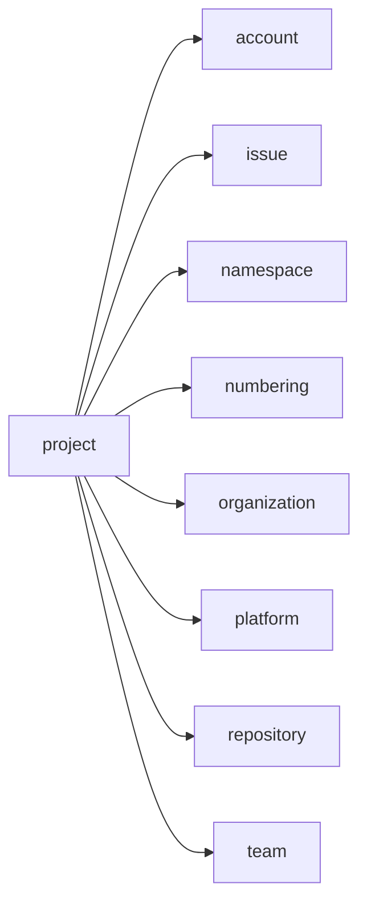
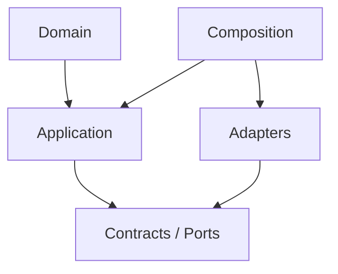

# project Owner Architecture

<!-- Generated from package.json and architecture/modules/*.json. -->

| Field | Value |
| --- | --- |
| Package module | @line_bot_v1/project |
| semanticOwner | project |
| moduleKind | domain-module |

## Boundary and dependencies

## Hexagonal placement

## Public surface

- ./application/management
- ./application/progress
- ./application/queries/project-collection
- ./composition/bootstrap/postgres-project-collection-store
- ./composition/bootstrap/postgres-project-management-store
- ./composition/bootstrap/project-content-scope
- ./composition/bootstrap/repository-imports
- ./contracts/dto/project-collection
- ./contracts/management
- ./contracts/output/content-scope
- ./domain

## Evidence

- [Manifest](./package.json)
- [Source](./src/)
- [Tests](./test/)
- [Module topology](../../architecture/modules/project.json)

