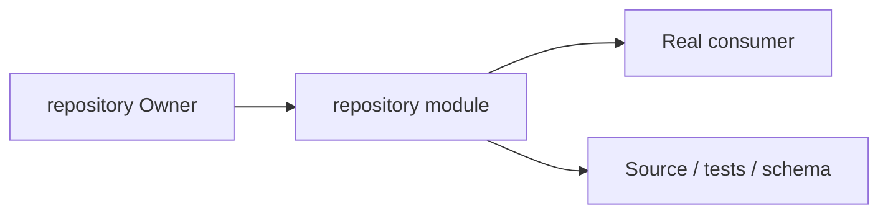
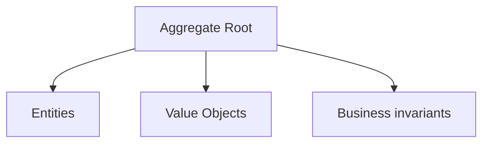
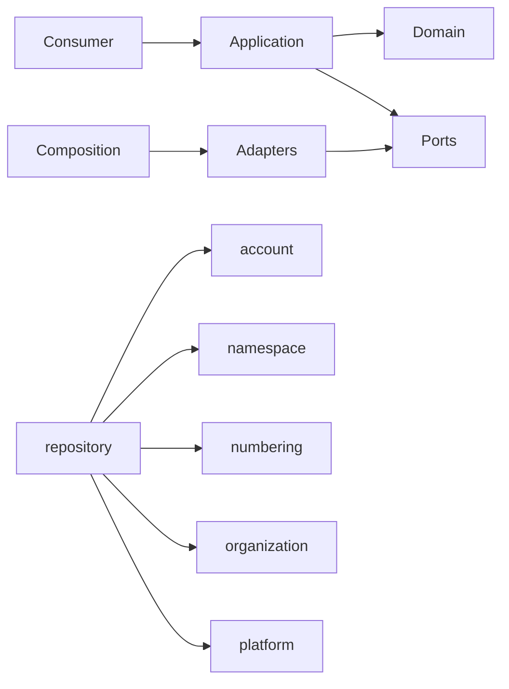

# repository Owner Architecture

<!-- Generated from package.json and architecture/modules/*.json. -->

## Context Card

| Field | Value |
| --- | --- |
| Owner | repository |
| Module | @line_bot_v1/repository |
| Kind | domain-module |

## Context Boundary

## Domain Model

## Boundary and Dependencies

## Key Invariants

- Domain invariants remain owned here.
- Authorization, isolation, replay, and version rules fail closed.

## Public Surface

- ./application/access
- ./application/address
- ./application/collection
- ./application/creation
- ./application/management
- ./application/public
- ./application/resource-management
- ./application/resources
- ./application/star-lists
- ./application/stars
- ./application/subscription
- ./contracts/discovery
- ./contracts/errors/repository-error
- ./contracts/input/repository-access
- ./contracts/input/repository-creation
- ./contracts/input/repository-management
- ./contracts/input/repository-subscription
- ./contracts/output/collection
- ./contracts/output/public
- ./contracts/output/resource-management
- ./contracts/output/resources
- ./contracts/repositories/address
- ./contracts/repositories/star-lists
- ./contracts/repositories/stars
- ./contracts/selectors
- ./domain/milestone/value-objects/milestone-number
- ./domain/repository/entities/repository
- ./domain/repository/value-objects/repository-capability
- ./domain/repository/value-objects/repository-name
- ./postgres
- ./postgres/access
- ./postgres/access-management
- ./postgres/address
- ./postgres/collection
- ./postgres/content-scope
- ./postgres/creation
- ./postgres/discovery
- ./postgres/explicit-recipient
- ./postgres/management
- ./postgres/public
- ./postgres/resource-management
- ./postgres/resources
- ./postgres/star-lists
- ./postgres/subscription

## Evidence

- [Manifest](./package.json)
- [Source](./src/)
- [Tests](./test/)
- [Module topology](../../architecture/modules/repository.json)

