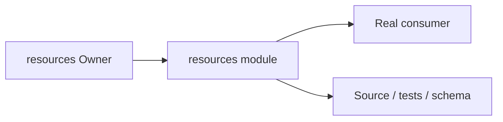
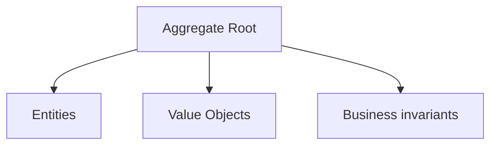
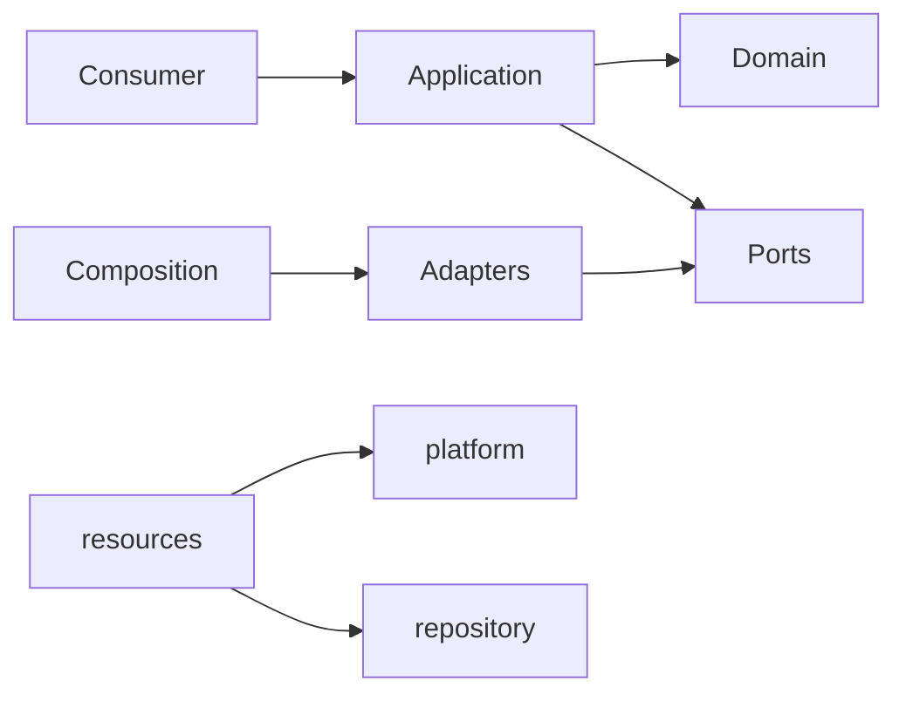

# resources Owner Architecture

<!-- Generated from package.json and architecture/modules/*.json. -->

## Context Card

| Field | Value |
| --- | --- |
| Owner | resources |
| Module | @line_bot_v1/resources |
| Kind | domain-module |

## Context Boundary

## Domain Model

## Boundary and Dependencies

## Key Invariants

- Domain invariants remain owned here.
- Authorization, isolation, replay, and version rules fail closed.

## Public Surface

- ./application/use-cases/resources
- ./composition/bootstrap/resource-references
- ./composition/bootstrap/resources
- ./contracts/dto/resources
- ./contracts/output/resource-references
- ./domain/resource-error
- ./domain/resource-reference

## Evidence

- [Manifest](./package.json)
- [Source](./src/)
- [Tests](./test/)
- [Module topology](../../architecture/modules/resources.json)

