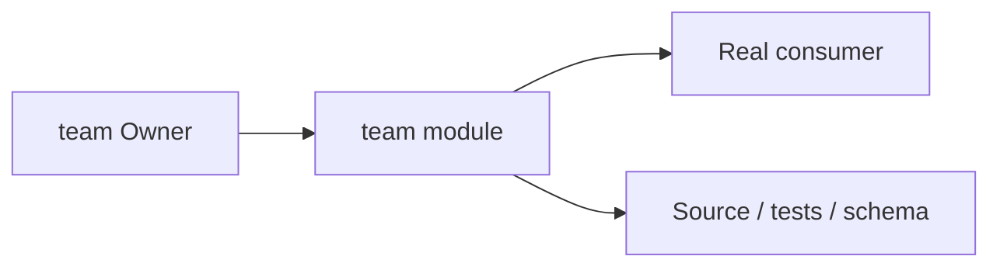
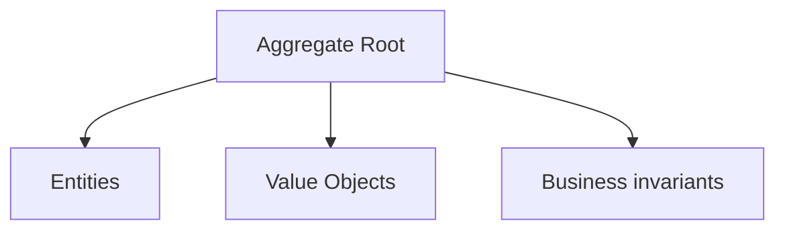
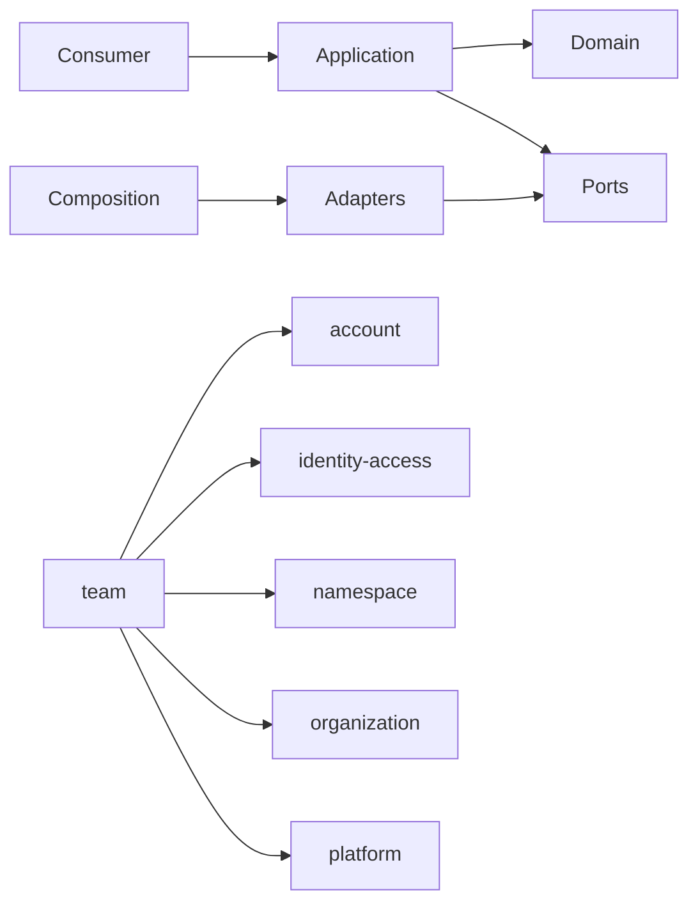

# team Owner Architecture

<!-- Generated from package.json and architecture/modules/*.json. -->

## Context Card

| Field | Value |
| --- | --- |
| Owner | team |
| Module | @line_bot_v1/team |
| Kind | domain-module |

## Context Boundary

## Domain Model

## Boundary and Dependencies

## Key Invariants

- Domain invariants remain owned here.
- Authorization, isolation, replay, and version rules fail closed.

## Public Surface

- ./application/collaboration
- ./application/commands/team-command
- ./application/commands/team-slug
- ./contracts
- ./contracts/errors/team-error
- ./contracts/input/team-command
- ./postgres
- ./postgres/project-access

## Evidence

- [Manifest](./package.json)
- [Source](./src/)
- [Tests](./test/)
- [Module topology](../../architecture/modules/team.json)

