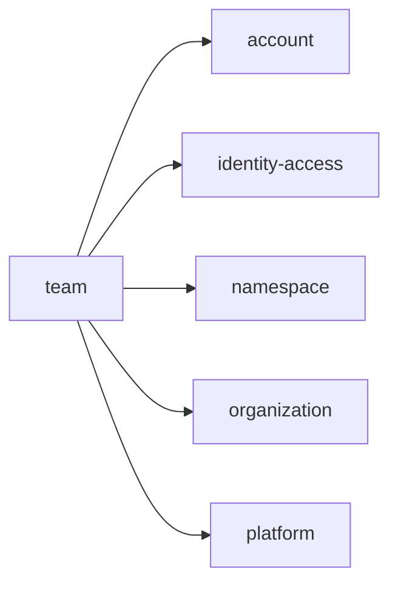
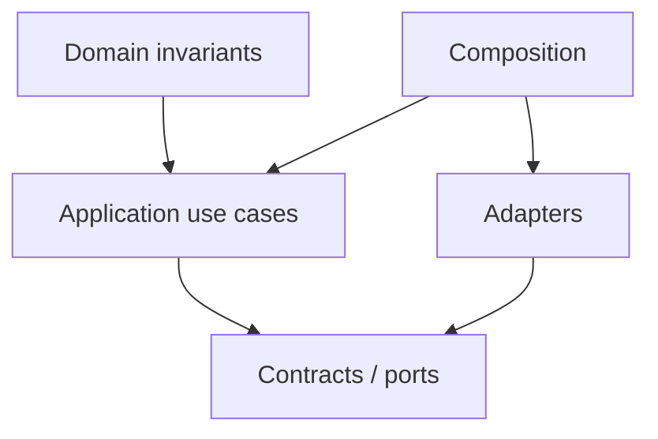

# team Owner Architecture

<!-- Generated from package.json and architecture/modules/*.json. -->

| Field | Value |
| --- | --- |
| Package module | @line_bot_v1/team |
| semanticOwner | team |
| moduleKind | domain-module |

## Boundary and dependencies

## Domain boundary

## Public surface

- ./application/collaboration
- ./application/commands/team-command
- ./application/commands/team-slug
- ./contracts
- ./contracts/errors/team-error
- ./contracts/input/team-command
- ./postgres
- ./postgres/project-access

## Evidence

- [Manifest](./package.json)
- [Source](./src/)
- [Tests](./test/)
- [Module topology](../../architecture/modules/team.json)

