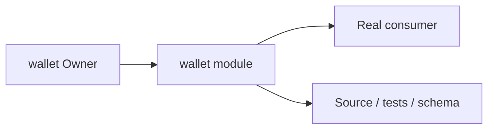
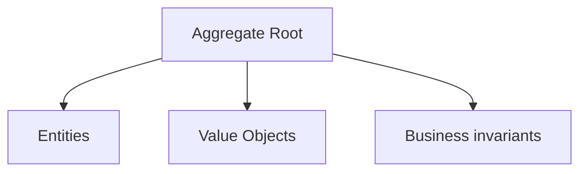
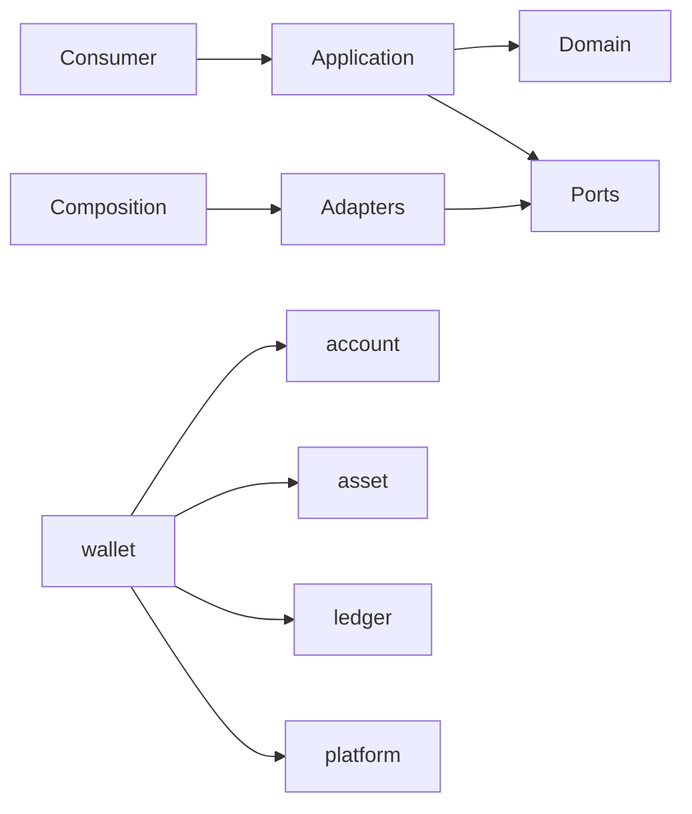

# wallet Owner Architecture

<!-- Generated from package.json and architecture/modules/*.json. -->

## Context Card

| Field | Value |
| --- | --- |
| Owner | wallet |
| Module | @line_bot_v1/wallet |
| Kind | domain-module |

## Implementation Status

| Area | Status |
| --- | --- |
| domain | present |
| application | required-but-missing |
| contracts | present |
| adapters | not-applicable |
| composition | not-applicable |
| test | required-but-missing |

## Context Boundary

## Domain Model

## Boundary and Dependencies

## Key Invariants

- Domain invariants remain owned here.
- Authorization, isolation, replay, and version rules fail closed.

## Public Surface

- ./contracts/repositories/wallet-repository
- ./domain/value-objects/wallet-balance
- ./postgres

## Evidence

- [Manifest](./package.json)
- [Source](./src/)
- [Tests](./test/)
- [Module topology](../../architecture/modules/wallet.json)

