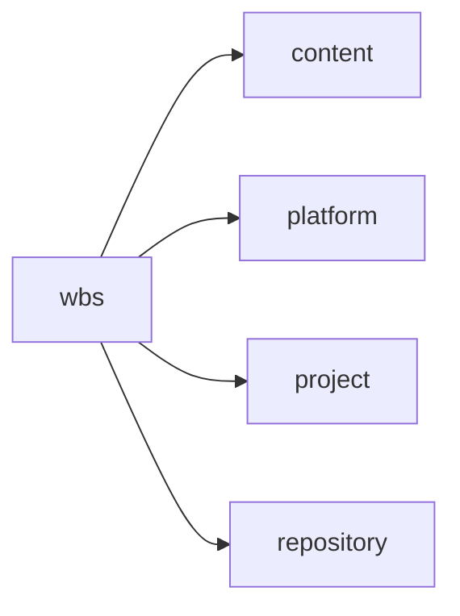
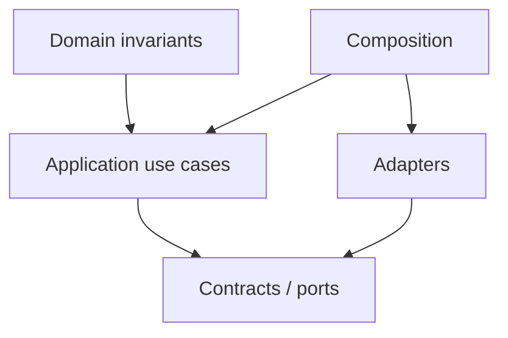

# wbs Owner Architecture

<!-- Generated from package.json and architecture/modules/*.json. -->

| Field | Value |
| --- | --- |
| Package module | @line_bot_v1/wbs |
| semanticOwner | wbs |
| moduleKind | domain-module |

## Boundary and dependencies

## Domain boundary

## Public surface

- ./application/commands/content
- ./application/commands/governance
- ./application/commands/project-content
- ./application/commands/project-governance
- ./application/commands/transfer
- ./application/use-cases/content
- ./application/use-cases/governance
- ./application/use-cases/legacy-entry
- ./application/use-cases/project-content
- ./application/use-cases/project-governance
- ./application/use-cases/transfer
- ./composition/bootstrap/baseline-events
- ./composition/bootstrap/legacy-entry
- ./composition/bootstrap/project-baseline-events
- ./composition/bootstrap/project-content
- ./composition/bootstrap/project-governance
- ./composition/bootstrap/project-metrics
- ./composition/bootstrap/scope-boundary
- ./composition/bootstrap/store
- ./composition/bootstrap/transfer
- ./contracts/dto/content
- ./contracts/dto/governance
- ./contracts/dto/project-content
- ./contracts/dto/project-governance
- ./contracts/dto/transfer
- ./contracts/output/baseline-events
- ./contracts/output/legacy-entry
- ./contracts/output/project-baseline-events
- ./contracts/output/project-metrics
- ./contracts/output/scope-boundary
- ./contracts/output/transfer
- ./contracts/repositories/content
- ./contracts/repositories/governance
- ./contracts/repositories/project-content
- ./contracts/repositories/project-governance
- ./contracts/repositories/transfer
- ./domain/content
- ./domain/document
- ./domain/governance
- ./domain/scope-governance
- ./domain/transfer

## Evidence

- [Manifest](./package.json)
- [Source](./src/)
- [Tests](./test/)
- [Module topology](../../architecture/modules/wbs.json)

