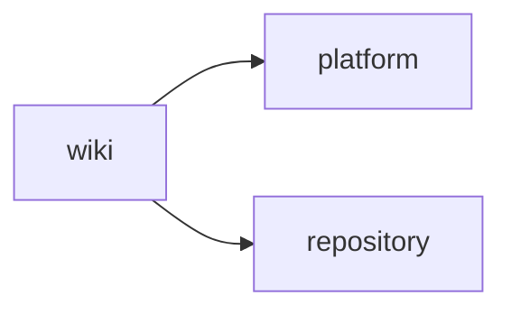
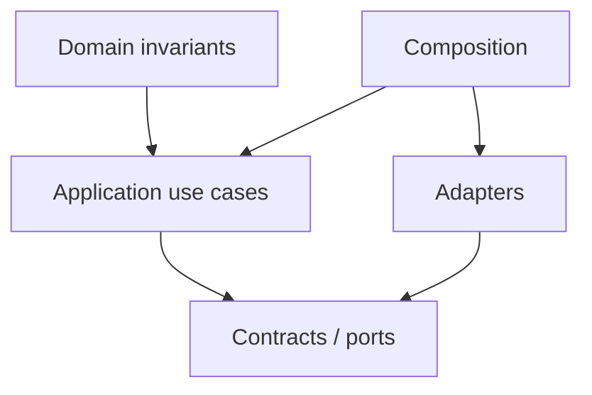

# wiki Owner Architecture

<!-- Generated from package.json and architecture/modules/*.json. -->

| Field | Value |
| --- | --- |
| Package module | @line_bot_v1/wiki |
| semanticOwner | wiki |
| moduleKind | domain-module |

## Boundary and dependencies

## Domain boundary

## Public surface

- ./application/commands/pages
- ./application/use-cases/history
- ./application/use-cases/pages
- ./composition/bootstrap/wiki-pages
- ./contracts/dto/wiki
- ./contracts/repositories/wiki-pages
- ./domain/policies/wiki-access
- ./domain/wiki-error

## Evidence

- [Manifest](./package.json)
- [Source](./src/)
- [Tests](./test/)
- [Module topology](../../architecture/modules/wiki.json)

